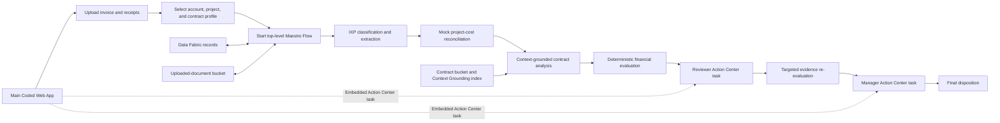

# Healthcare Invoice Assurance — Approved Design

**Status:** Approved for planning

**Date:** 2026-08-07

**Phase:** Design only; no UiPath assets have been created

**Delivery model:** UiPath Automation Cloud

## 1. Purpose

Healthcare Invoice Assurance is an AI-assisted invoice review demonstration for contract-governed project spending. It accepts an invoice and supporting receipts, determines the governing contract stack, evaluates charges against grounded clauses, routes human review and approval through Action Center, and preserves an explainable audit trail.

The demonstration is intentionally not a purchase-order matching workflow. A lightweight project-cost reconciliation validates supplier, project, invoice, and register data without making PO matching the center of the experience.

## 2. Approved design principles

1. Use one logical Automation Cloud solution with one top-level Maestro Flow.
2. Keep the workflow linear; do not model the experience as Case Management stages.
3. Use a hybrid intelligence model:
   - IXP extracts invoice and receipt data.
   - Context Grounding retrieves contract evidence.
   - A UiPath Agent interprets clause applicability and produces structured rule proposals.
   - A deterministic Coded Function performs all financial calculations.
4. Use a Main Coded Web App as the single pane of glass.
5. Embed Action Center tasks inside the Main App rather than opening new windows.
6. Reuse one Coded Action App for Reviewer and Manager task modes.
7. Store structured records in Data Fabric and binary documents in Storage Buckets.
8. Treat all seeded expected findings as evaluation fixtures, never runtime constants.
9. Use fictional names in configuration and case data; never hard-code customer names in reusable logic.
10. Apply UiPath Apollo Vertex design guidance first and the `uipath-brand-ui-jmr` guidance second.

## 3. Logical architecture

The logical solution has three deployment boundaries:

- A `.uipx` solution for the Maestro Flow and registered supporting projects/resources.
- An independently deployed Coded Web App.
- An independently deployed reusable Coded Action App.

This is a known platform-packaging distinction: Coded Apps are part of the logical solution but are not registered inside the `.uipx` package.

## 4. Live user journey

1. The user opens **New Analysis** in the Main App.
2. The user uploads the invoice and supporting receipts.
3. The user selects an account/project and its contract profile.
4. The contract profile resolves a pre-hosted Storage Bucket and Context Grounding index.
5. Submit creates the Assurance Case and starts the Maestro Flow.
6. The Main App shows live progress through extraction, reconciliation, contract analysis, and calculation.
7. Maestro creates a Reviewer Action Center task.
8. The Main App finds the task for the process instance and embeds it in the workspace.
9. The reviewer corrects the register mismatch, records evidence follow-up, uploads the collected PPE receipt, and submits the task.
10. Maestro re-evaluates only the affected PPE finding and recalculates totals.
11. If evidence is still insufficient, Maestro creates another Reviewer task; otherwise it creates a Manager task.
12. The Manager approves, returns, or rejects through the same embedded Action App in Manager mode.
13. Maestro records the final disposition and closes the workflow.

`Awaiting Evidence` is a status on the finding and activity timeline while the process remains at the Reviewer user task. It is not a case stage.

## 5. Contract-analysis boundary

The selected contract profile identifies the contract family, index, precedence policy, tolerances, and review groups. Runtime analysis must:

- Filter candidate documents to those effective on the invoice date.
- Apply configured document precedence.
- Evaluate precedence by topic because a later amendment supersedes only topics it addresses.
- Return the source document, clause, normalized rule type, rule operands, explanation, and confidence.
- Flag ambiguity instead of inventing a rule.

The reviewer may enter a text-only governing-context override. The override:

- Applies only to the already indexed document set.
- Requires a reason.
- Is stored as a Human Decision.
- Is prominently labeled in downstream findings and audit events.
- Is never presented as contract evidence.

## 6. Generic financial evaluator

The deterministic evaluator supports reusable rule types rather than scenario-specific amounts:

- Labor rate limit.
- Overtime multiplier or explicit overtime rate.
- Percentage cap over a defined eligible base.
- Daily or unit equipment cap.
- Evidence requirement above a threshold.
- Categorical exclusion.
- Invoice-to-register reconciliation.
- Supporting-document-to-line reconciliation.

Its calculation ledger records submitted amount, allowed amount, adjustment, rule identifier, source clause, evidence reference, and calculation trace for every evaluated charge.

The evaluator must not contain the supplied invoice number, supplier, seeded rates, seeded caps, expected findings, expected adjustment, or expected payable amount.

## 7. Evaluation fixture, not runtime behavior

The Northbridge/Lakeshore documents are a canonical evaluation fixture. When the system operates correctly, it should independently derive the documented results for that fixture. Those results do not appear in runtime prompts or product logic.

The Demo Guide and answer key must remain outside:

- The Context Grounding index.
- Agent prompt context.
- IXP training inputs used for runtime extraction.
- Production Data Fabric records.

Evaluation coverage must include:

- The canonical seeded package.
- Mutations to quantities, rates, dates, and evidence.
- Different supported invoices against the same contract.
- Fully compliant invoices.
- Previously unseen combinations of supported exception types.
- Adversarial checks that fail any implementation reproducing memorized scenario answers.

### Canonical evaluation oracle — test-only

The following assertions are available only to the evaluation harness and human demo guide. They must never be added to the Agent instructions, Context Grounding index, Contract Profile, Flow logic, or evaluator implementation.

| Evaluation assertion | Expected result for the supplied fixture |
|---|---|
| Carpenter labor | 160 hours claimed at $130 versus $115 allowed; $2,400 proposed adjustment |
| Small tools | $1,702.40 claimed versus a 3% cap on $34,048 submitted eligible craft labor ($1,021.44); $680.96 adjustment |
| Scissor lift | 10 days claimed at $425 versus $375 allowed; $500 adjustment |
| PPE | $915 pending adjustment while the required itemized receipt is absent; clear the adjustment after valid evidence |
| Alcohol | $68.50 excluded while the separately pre-approved meal remainder stays allowable |
| Register tie-out | $63,024.90 invoice versus $62,874.90 register; $150 reconciliation correction with no added deduction |
| Initial snapshot | $4,564.46 potential adjustment and $58,460.44 proposed payable |
| Post-evidence snapshot | $3,649.46 adjustment and $59,375.44 proposed payable |
| Compliant charges | Electrician straight time at $138, 24 overtime hours at $207, $1,248 power-quality testing, compliant generator/boom-lift, supported materials, and documented subcontractors remain unadjusted |

The small-tools oracle deliberately uses the contract-defined submitted eligible craft-labor base, even though a separate carpenter-rate finding changes the allowed labor amount.

## 8. Human-in-the-loop model

Every invoice requires separate Reviewer and Manager approval roles. For the live demo, one signed-in account may belong to both groups so the presenter can complete both tasks in one session. A production configuration must preserve separate identities and segregation of duties.

The Reviewer task remains open while the reviewer collects evidence. The reusable Action App supports:

- Save and exit without task completion.
- Register correction with required reason.
- Evidence-request notes and status.
- PPE receipt upload.
- Finding dispositions and comments.
- Submit review.

The Manager mode supports:

- Final financial summary.
- Reviewer corrections and decisions.
- Contract citations and evidence history.
- Approve, Return to Reviewer, and Reject.

## 9. Data and audit model

Data Fabric stores:

- Contract Profile.
- Assurance Case.
- Source Document metadata.
- Analysis Run.
- Charge.
- Finding.
- Evidence Request.
- Human Decision.
- Audit Event.

Storage Buckets store immutable uploaded packages, evidence, and contract libraries. Each source document has a checksum and versioned bucket reference. Every submission receives a correlation ID shared by Maestro, tasks, documents, analysis runs, and audit events. Re-analysis creates a new Analysis Run and never overwrites the prior result.

## 10. User experience and visual system

The Main App contains:

- Portfolio.
- New Analysis.
- Processing.
- Case Workspace.
- Contract Library.

Apollo Vertex is the first-priority design system:

- Use `@uipath/apollo-wind` components instead of custom raw controls.
- Use Apollo semantic tokens instead of raw color values.
- Default to Apollo light theme and provide a dark-theme toggle.
- Use Apollo spacing, focus, loading, validation, responsive, and accessibility behavior.

The secondary UiPath brand layer supplies restrained Robotic Orange and Agentic Teal semantics, approved typography, official logo usage, direct microcopy, and sparse pixel accents. It must not override Apollo interaction patterns or accessibility states.

## 11. Real, mocked, and deferred behavior

### Real in the demonstration

- Upload and submission.
- Maestro orchestration.
- IXP extraction.
- Context Grounding retrieval.
- Agent analysis.
- Deterministic calculations.
- Data Fabric persistence.
- Embedded Action Center work.
- Evidence upload and targeted re-evaluation.
- Final approval and audit history.

### Intentionally mocked

- Project-cost-system lookup through a deterministic API Workflow adapter.
- External supplier communication; the reviewer records the interaction.

### Deferred

- ERP posting and payment release.
- Production identity design.
- Live email or supplier portal integration.
- Historical portfolio metrics until a separate mock-data request.

## 12. Source-pack corrections agreed during design

Before implementation evaluation, update the fictional source pack so that:

1. The July project addendum explicitly pre-approves the business meal. This preserves the intended food allowance while leaving alcohol excluded.
2. The reconciliation clause states that the invoice total must match the cost-register total and that each subcontractor line must match its corresponding supporting invoice.

These are source-document corrections, not runtime special cases.

## 13. Reliability requirements

- Prevent duplicate submission with a package fingerprint.
- Distinguish project lookup `Not Found` from `Search Incomplete`.
- Convert low-confidence extraction into a reviewer-visible validation item.
- Prevent ambiguous clauses from producing automatic deductions.
- Retry malformed Agent output within a bounded policy, then surface a technical-review item.
- Never silently substitute the evaluation answer key.
- Preserve retry, override, correction, and failure events in the audit trail.
- Provide a deterministic reset procedure for the demo dataset.

## 14. SDD set

- [Solution overview](healthcare-invoice-assurance-solution-sdd.md)
- [Maestro Flow](invoice-assurance-flow-sdd.md)
- [Contract Compliance Agent](contract-compliance-agent-sdd.md)
- [Main Coded Web App](invoice-assurance-main-app-sdd.md)
- [Reusable Coded Action App](invoice-assurance-action-app-sdd.md)
- [Financial Rules Evaluator](financial-rules-evaluator-sdd.md)
- [Project Cost Lookup API Workflow](project-cost-lookup-api-sdd.md)

## 15. Planning boundary

This document and the linked SDDs define architecture only. They do not contain an implementation task list and do not authorize creation, publishing, or deployment of UiPath assets.
