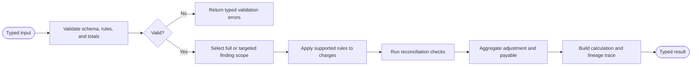

# Solution Design Document — FinancialRulesEvaluator

## Document History

| Date | Version | Author | Role | Comments |
|---|---|---|---|---|
| 2026-08-07 | 1.0 | Codex | Generated by AI Agent | Initial interactive SDD |

<!-- DO NOT RENAME: uipath-planner detects SDDs via this exact heading or the marker below. -->
<!-- planner-handoff:v1 -->
## Planner Handoff

| Field | Value |
|---|---|
| **Execution autonomy** | interactive |
| **Delivery model** | cloud |
| **SDD scope** | solution |
| **Project list section** | §9 Project Structure + §8 Consumers |
| **Tasks file** | `financial-rules-evaluator-tasks.md` |
| **Generated by** | uipath-planner |
| **Generation date** | 2026-08-07 |

## Recommended Scope

**Recommendation:** Python Coded Function inside the Healthcare Invoice Assurance logical solution

**Delivery model:** cloud

**Blocked by platform:** none

## Table of Contents

1. Function Overview
2. Input Schema
3. Output Schema
4. Supported Rule Model
5. Execution Flow
6. Error Handling
7. Performance and Security
8. Consumers
9. Project Structure
10. Testing Strategy
11. Next Steps

## 1. Function Overview

| Field | Value |
|---|---|
| **Function name** | FinancialRulesEvaluator |
| **Objective** | Convert validated, grounded rule proposals and canonical charges into authoritative findings and financial snapshots |
| **Runtime** | Python Coded Function with Orchestrator job semantics |
| **Primary caller** | `InvoiceAssuranceFlow` |
| **Invocation mode** | Initial full evaluation or targeted re-evaluation |

### In Scope

- Validate supported normalized rule types and operands.
- Match generic rules to canonical charge attributes.
- Calculate allowed amounts and adjustments.
- Validate invoice/register relationships.
- Produce a line-level calculation trace.
- Recalculate aggregate adjustment and payable snapshots.
- Preserve unaffected finding lineage during targeted re-evaluation.

### Out of Scope

- LLM or Context Grounding calls.
- Contract interpretation.
- Hard-coded invoice identifiers, suppliers, rates, caps, findings, or expected totals.
- Human approval decisions.
- ERP posting.

## 2. Input Schema

| Field | Type | Required | Description |
|---|---|---|---|
| `correlationId` | string | Yes | Cross-component trace identifier |
| `assuranceCaseId` | string | Yes | Case record identifier |
| `analysisRunId` | string | Yes | Analysis version requesting evaluation |
| `mode` | enum | Yes | `initial` or `targeted` |
| `currency` | string | Yes | Invoice currency |
| `invoiceSubmittedTotal` | decimal | Yes | Submitted invoice total |
| `canonicalCharges` | array[Charge] | Yes | Normalized charges with source/evidence references |
| `normalizedRules` | array[Rule] | Yes | Schema-valid grounded rules proposed by the Agent |
| `proposedFindings` | array[FindingProposal] | Yes | Agent charge/rule associations and evidence state |
| `reconciliationResult` | object | Yes | Project/invoice/register comparison |
| `previousSnapshot` | object/null | For targeted mode | Prior authoritative findings and totals |
| `changedFindingIds` | array[string] | For targeted mode | Findings allowed to be re-evaluated |

All monetary fields use decimal semantics. Binary floating-point values are not the source of record.

## 3. Output Schema

| Field | Type | Always Present | Description |
|---|---|---|---|
| `status` | enum | Yes | `valid`, `invalid`, or `technicalError` |
| `authoritativeFindings` | array | Yes | Validated findings with monetary/non-monetary effects |
| `calculationLines` | array | Yes | Charge, rule, operands, submitted, allowed, adjustment, and trace |
| `financialSnapshot` | object/null | Yes | Submitted total, total adjustment, proposed payable, currency, version |
| `reconciliationState` | object | Yes | Invoice/register and supporting-document states |
| `validationErrors` | array | Yes | Unsupported/missing/inconsistent rule details |
| `preservedFindingIds` | array | Yes | Unaffected findings carried forward in targeted mode |
| `traceVersion` | string | Yes | Evaluator schema/calculation version |
| `errorType` | string | Yes | Empty on success; typed on failure |
| `errorMessage` | string | Yes | Empty on success; safe technical summary on failure |

## 4. Supported Rule Model

### Common rule fields

| Field | Description |
|---|---|
| `ruleId` | Stable identifier within the analysis run |
| `ruleType` | Supported generic evaluator operation |
| `scope` | Charge categories, dates, supplier/project, and inclusion/exclusion filters |
| `operands` | Rates, multipliers, percentages, caps, thresholds, or required evidence types |
| `effectivePeriod` | Rule-effective date range |
| `sourceDocumentId` | Indexed governing document identifier |
| `sourceClause` | Clause/section reference |
| `confidence` | Agent confidence used for validation policy, not calculation |

### Supported rule types

| Rule Type | Generic behavior |
|---|---|
| `LaborRateLimit` | Limit eligible units to a straight-time or explicit rate |
| `OvertimeRule` | Apply explicit overtime rate or validated multiplier |
| `PercentageCap` | Cap a category using a percentage of a defined eligible submitted base |
| `EquipmentUnitCap` | Cap equipment by day/unit and eligible quantity |
| `EvidenceRequirement` | Mark amount pending/non-allowable when required evidence is absent |
| `CategoryExclusion` | Exclude a defined category when the clause applies |
| `InvoiceRegisterTieOut` | Compare invoice total to register total without automatically treating variance as deduction |
| `SupportingDocumentTieOut` | Compare a register line to its corresponding supporting invoice |

Unsupported rule types produce typed validation errors and cannot become authoritative adjustments.

### Calculation principles

- Determine applicability from structured scope fields, not supplier/invoice literals.
- Apply rule-specific bases exactly as declared, including submitted-versus-allowed distinctions.
- Round currency only at defined rule and snapshot boundaries.
- Preserve original operands and intermediate values in the calculation trace.
- Reconcile aggregate charge results back to the submitted invoice total.
- In targeted mode, reject attempts to modify findings outside `changedFindingIds`.
- Same validated input produces the same output.

## 5. Execution Flow



### Step details

| # | Step | Input | Output | Control |
|---|---|---|---|---|
| 1 | Validate request | Typed input | Validated request/errors | Required fields, enums, decimals, identifiers |
| 2 | Validate rules | Normalized rules | Supported rules/errors | Citation and operand completeness |
| 3 | Validate package totals | Charges and invoice total | Reconciled base/errors | Detect missing/duplicate charge lines |
| 4 | Select evaluation scope | Mode and finding IDs | Working finding set | Targeted scope cannot widen silently |
| 5 | Apply rule functions | Rules and charges | Calculation lines | One deterministic handler per generic rule type |
| 6 | Evaluate reconciliation | Register/supporting references | Non-monetary/mapped findings | Variance does not imply deduction by default |
| 7 | Aggregate snapshot | Calculation lines | Financial snapshot | Submitted minus authoritative adjustments |
| 8 | Validate output | Snapshot and lineage | Final result/errors | Totals, IDs, preserved findings, trace version |

## 6. Error Handling

| Error Type | Trigger | Function response |
|---|---|---|
| `INVALID_INPUT` | Missing/invalid typed field | `status=invalid`; field errors; no snapshot promoted |
| `UNSUPPORTED_RULE` | Unknown rule type | Validation error with rule ID; no guessed calculation |
| `MISSING_OPERAND` | Required rate/cap/base absent | Validation error with clause/rule reference |
| `UNGROUNDED_RULE` | Missing source document or clause | Reject monetary rule |
| `TOTAL_MISMATCH` | Canonical charges cannot reconcile to invoice total | Invalid result for reviewer/technical handling |
| `TARGET_SCOPE_VIOLATION` | Targeted request attempts unrelated change | Reject re-evaluation result |
| `ARITHMETIC_INVARIANT` | Adjustment/payable or aggregate identities fail | Technical error and full trace metadata |
| `UNEXPECTED_FAILURE` | Unhandled internal exception | Typed `errorType`/safe message; no exception allowed to become a partial success |

The entrypoint returns typed error fields instead of relying on uncaught exceptions as business output.

## 7. Performance and Security

| Metric | Target |
|---|---|
| Typical evaluation latency | Under 5 seconds for demo-size packages |
| Determinism | Identical validated inputs produce identical outputs |
| Precision | Decimal currency handling with explicit rounding boundaries |
| Trace coverage | 100% of authoritative monetary findings |

Security constraints:

- No LLM calls.
- No secrets or external connections required for calculation.
- Input/output traces exclude document binaries and sensitive tokens.
- Only supported rule schemas can influence financial output.
- Runtime expected values and answer keys are never loaded.

## 8. Consumers

| Consumer | Usage Pattern |
|---|---|
| `InvoiceAssuranceFlow.evaluateFinancials` | Full initial evaluation after Agent output validation |
| `InvoiceAssuranceFlow.ReevaluateAffectedFindings` | Targeted evaluation after Reviewer evidence or contract override |

The Main App and Action App display persisted evaluator output; they do not invoke the Function directly.

## 9. Project Structure

```text
FinancialRulesEvaluator/
├── main.py
├── pyproject.toml
├── uipath.json
├── entry-points.json       # generated by functions init
├── bindings.json           # generated by functions init
├── project.uiproj          # generated by functions init
└── tests/
```

Architecture constraints:

- Python Coded Function, not an Agent.
- Typed Pydantic input/output models.
- Function map in `uipath.json` identifies the callable entrypoint.
- No manually invented generated metadata.
- Published callable package is bound into the logical solution for Flow invocation.

## 10. Testing Strategy

### Canonical fixture test

Supply Agent-derived normalized rules and charges from the fictional package, then compare the independently computed output to the test-only oracle in the approved design specification. Assert the initial $4,564.46 adjustment and $58,460.44 payable, then assert that valid PPE evidence changes only the affected finding and produces a $3,649.46 adjustment and $59,375.44 payable. The $150 register correction must never increase the adjustment.

These figures are test assertions only. A source scan must verify that they do not appear in the Function implementation or runtime configuration.

### Unit tests

| Area | Tests |
|---|---|
| Labor rates | Below/equal/above limit; different quantities and dates |
| Overtime | Explicit rate, multiplier, excluded premium base |
| Percentage caps | Different eligible bases, exclusions, and boundary amounts |
| Equipment caps | Unit/day quantities and multiple equipment classes |
| Evidence requirements | Below/above threshold; missing, invalid, and valid evidence |
| Exclusions | Allowed categories and excluded subcategories |
| Reconciliation | Exact tie, positive/negative variance, structured correction |
| Aggregation | Currency precision, rounding, zero/negative guards, total invariants |
| Targeted mode | Only changed finding updates; unrelated findings preserved |

### Generalization tests

- Change every canonical amount while retaining the same rule shapes.
- Analyze a different supported invoice under the same contract profile.
- Analyze a fully compliant invoice.
- Combine exception types not present in the canonical fixture.
- Verify no literal seeded amount or invoice identifier is present in source/configuration.

### Error-path tests

- Missing citation.
- Unsupported rule type.
- Malformed decimal.
- Duplicate charge ID.
- Invoice/charge total mismatch.
- Targeted-scope widening.
- Forced internal exception returns typed failure.

## 11. Next Steps

This SDD captures architecture only. If implementation is authorized later, load `uipath-planner` with this file or the solution overview to derive a separate task list routed to `uipath-functions`. No Function asset is created by this document.
