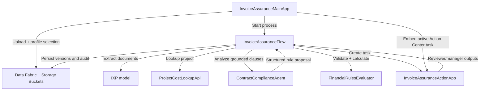

# Solution Design Document — Healthcare Invoice Assurance

## Document History

| Date | Version | Author | Role | Comments |
|---|---|---|---|---|
| 2026-08-07 | 1.0 | Codex | Generated by AI Agent | Initial architecture approved interactively |
| 2026-08-08 | 1.1 | Codex | Generated by AI Agent | Added approved Automation Cloud deployment bindings |
| 2026-08-08 | 1.2 | Codex | Generated by AI Agent | Bound the prepared IXP project and documented its readiness gate |
| 2026-08-08 | 1.3 | Codex | Generated by AI Agent | Simplified the demo Data Fabric model to three entities |
| 2026-08-08 | 1.4 | Codex | Generated by AI Agent | Required folder-scoped Data Fabric entities in `AMER Presales/HLS` |
| 2026-08-08 | 1.5 | Codex | Generated by AI Agent | Added a durable Codex implementation-goal handoff |

<!-- DO NOT RENAME: uipath-planner detects SDDs via this exact heading or the marker below. -->
<!-- planner-handoff:v1 -->
## Planner Handoff

| Field | Value |
|---|---|
| **Execution autonomy** | interactive |
| **Delivery model** | cloud |
| **SDD scope** | solution |
| **Project list section** | §2 Project Inventory |
| **Tasks file** | `healthcare-invoice-assurance-tasks.md` |
| **Generated by** | uipath-planner |
| **Generation date** | 2026-08-07 |

**Cross-project ordering:** establish shared data/document resources first; build callable Agent, Function, and API Workflow before binding them into the Flow; deploy the Action App before configuring Flow AppTasks; deploy the Main App after runtime identifiers and OAuth scopes are known.

## Recommended Scope

**Recommendation:** Solution(Maestro Flow, Agent, Coded Web App, Coded Action App, Coded Function, API Workflow)

**Delivery model:** cloud

**Blocked by platform:** none

## 1. Solution Overview

### Objective

Provide a reusable, evidence-led invoice assurance workflow that analyzes uploaded invoices and receipts against a selected indexed contract family, calculates adjustments deterministically, and routes review and approval through embedded Action Center tasks.

### Business context

The solution demonstrates an Office of the CFO control for healthcare project invoices. It emphasizes contract compliance, supporting evidence, explainable exceptions, and a complete audit trail. It does not depend on PO matching or a live ERP.

### In scope

- Live upload and submission from a Coded Web App.
- IXP classification and extraction.
- Mock project-cost reconciliation.
- Effective contract-stack analysis using Context Grounding.
- Generic deterministic financial evaluation.
- Reviewer and Manager Action Center tasks.
- Single-pane task embedding.
- Evidence upload and targeted re-evaluation.
- Data Fabric records, Storage Buckets, audit history, and operational KPIs.

### Out of scope

- Case Management stages.
- Live ERP posting or payment release.
- Live supplier email or portal exchange.
- Production identity design.
- PHI processing.
- Fraud, legal, or misconduct conclusions.
- Hard-coded findings or seeded financial outcomes.

## 2. Project Inventory

| # | Project | Product | Role | Packaging |
|---|---|---|---|---|
| 1 | `InvoiceAssuranceFlow` | Maestro Flow | Linear orchestration, live status, HITL routing, re-evaluation loop | Registered in `.uipx` |
| 2 | `ContractComplianceAgent` | Low-code autonomous Agent | Grounded clause applicability and structured rule proposals | Registered in `.uipx` |
| 3 | `InvoiceAssuranceMainApp` | Coded Web App | Intake, portfolio, progress, invoice workspace, embedded tasks | Independent Coded App deployment |
| 4 | `InvoiceAssuranceActionApp` | Coded Action App | Reusable Reviewer and Manager task surface | Independent Coded App deployment |
| 5 | `FinancialRulesEvaluator` | Python Coded Function | Deterministic rule validation, calculations, and financial snapshots | Published callable package; solution-bound resource |
| 6 | `ProjectCostLookupApi` | API Workflow | Deterministic mock project-cost lookup | Registered in `.uipx` |

### Supporting platform resources

| Resource | Approved binding | Purpose |
|---|---|---|
| Contract Storage Bucket | `healthcare-invoice-assurance-contractFiles` (`6dfc0608-733a-4465-9811-59e87d5095cb`; numeric ID `204616`) | Pre-hosted fictional agreements and amendments |
| Invoice Package Storage Bucket | `healthcare-invoice-assurance-uploadedInvoices` (`11c5ae0b-2ef6-495a-b6b7-d79e7e6f7633`; numeric ID `204617`) | Uploaded invoices, receipts, and evidence responses |
| Context Grounding index | `healthcare-invoice-assurance-contractsIndex` | Confirmed contract retrieval index linked to the contract bucket |
| Data Fabric entities | `HLS_InvoiceAssurance_Main`, `HLS_InvoiceAssurance_LineItems`, `HLS_InvoiceAssurance_Activity`; create as folder-scoped resources in `AMER Presales/HLS` | Demo-grade invoice header, line-item/reconciliation, and append-only activity records; tenant-scoped entities are prohibited |
| IXP project/model | `Healthcare Invoice Assurance`; name `healthcare-invoice-assurance-51392a38-ixp`; ID `43a0c85c-5d97-80f8-9f1f-2ac01bae3742` | Custom mixed-package classification and extraction |
| Action Center assignment policy | Unassigned task pool | Reviewer and Manager tasks remain unassigned until an eligible user claims them |

### IXP extraction readiness

The prepared IXP project is the authoritative extraction project for this solution. It replaces a direct binding to the generic out-of-the-box invoice model because the runtime package contains heterogeneous document types and requires a shared normalized output.

At design update time, the project has model version `0` but no extraction fields, published/pinned version, or deployment tag. Before `InvoiceAssuranceFlow.extractPackage` can be bound, implementation must:

1. Configure taxonomy groups and fields for document type, invoice headers, charge lines, supporting receipts/invoices, and cost-register totals/lines.
2. Upload representative fictional documents, review predictions, and validate required fields and repeatable line items.
3. Publish the validated model version and make it available to `AMER Presales/HLS`.
4. Bind the resulting published model resource into the Studio Web solution and Flow.

The IXP project must return extraction confidence and source coordinates so low-confidence values can be surfaced for human review. The Demo Guide and expected-findings answer key must never be uploaded as IXP training or validation input.

### Deployment environment

| Setting | Approved value | Implementation note |
|---|---|---|
| Automation Cloud | `https://cloud.uipath.com/` | Cloud delivery model |
| Organization | `uipathlabs` | Authoritative organization target |
| Tenant | `Playground` | Authoritative tenant target |
| Orchestrator folder | `AMER Presales/HLS` | All folder-scoped runtime resources are bound here |
| Numeric folder ID | `2036001` | Use where the API requires the organization-unit ID |
| Folder GUID/key | `79d872b0-bee1-4264-a6de-3e780f4e4239` | Required by CLI/SDK operations that do not accept the numeric ID |
| Data Fabric scope | Folder: `AMER Presales/HLS` | Create and bind all three entities in this folder; do not use tenant-scoped entities |
| Studio Web solution | `Healthcare Invoice Assurance` | Reuse this exact solution name; do not create a second similarly named solution |

The implementation session must verify this target before any platform write. A CLI login to another organization or tenant is not an acceptable deployment context. Build and deployment actions use the builder's user-delegated UiPath login and effective permissions.

## 3. Cross-Project Data Flow

### Shared identifiers

All boundaries carry:

- `correlationId`.
- `invoiceRecordId`.
- `processInstanceId` when available.
- `contractProfileId`.
- `analysisVersion`.
- Source-document and task identifiers relevant to the call.

### Runtime sequence

1. The Main App validates upload and profile selection.
2. Documents are stored and the `HLS_InvoiceAssurance_Main` header record is created.
3. The Main App starts `InvoiceAssuranceFlow`.
4. Flow invokes IXP and normalizes extraction output.
5. Flow invokes `ProjectCostLookupApi`.
6. Flow invokes `ContractComplianceAgent` with charges, invoice date, profile, and index binding.
7. Flow invokes `FinancialRulesEvaluator` with canonical charges and normalized proposed rules.
8. Flow creates the Reviewer AppTask.
9. Reviewer work remains pending while evidence is collected and saved.
10. On submit, Flow persists decisions and invokes targeted re-evaluation.
11. A failed evidence gate loops to another Reviewer AppTask; a passed gate advances to Manager approval.
12. Final outcome and financial snapshot are stored.

## 4. Shared Data Definitions

| Entity | Key fields | Ownership |
|---|---|---|
| `HLS_InvoiceAssurance_Main` | system ID; correlation/process IDs; invoice, supplier, account/project, and profile metadata; processing status; current totals; open-finding count; awaiting-evidence flag; analysis version; `FindingsJson`; `DocumentReferencesJson` | Main App creates the header; Flow owns status and current analysis updates |
| `HLS_InvoiceAssurance_LineItems` | `InvoiceRecordId`; source document/type; description/category; quantity/unit; submitted rate/amount; IXP confidence/coordinates; external record/match state/amount; variance; allowed amount; adjustment; evaluation status | Flow normalizes IXP output and upserts current extracted/reconciled/evaluated lines |
| `HLS_InvoiceAssurance_Activity` | `InvoiceRecordId`; event timestamp/type; actor; source component; summary; analysis version; `PayloadJson` | Flow appends automation, evidence, correction, task, reviewer, manager, retry, and outcome events |

### Data ownership rules

- `HLS_InvoiceAssurance_Main`, `HLS_InvoiceAssurance_LineItems`, and `HLS_InvoiceAssurance_Activity` must be created as folder-scoped Data Fabric entities in `AMER Presales/HLS` (numeric folder ID `2036001`; GUID/key `79d872b0-bee1-4264-a6de-3e780f4e4239`).
- Tenant-scoped entities, or same-named entities in any other folder, must not be created or bound for this solution.
- Every component must execute Data Fabric reads and writes with the `AMER Presales/HLS` folder context.
- Data Fabric is the structured system of record.
- Storage Buckets are the binary system of record.
- Maestro owns process state, not the long-term business record.
- `InvoiceRecordId` is a simple string link from line-item and activity rows to the system ID of `HLS_InvoiceAssurance_Main`; formal relationship fields are unnecessary for this demo.
- `HLS_InvoiceAssurance_Main.FindingsJson` stores the latest structured findings, citations, evidence state, reviewer dispositions, and calculation traces; commonly filtered values remain first-class header fields.
- `HLS_InvoiceAssurance_Main.DocumentReferencesJson` stores immutable bucket references, checksums, types, and versions; document binaries are not stored in Data Fabric.
- Re-analysis increments `AnalysisVersion`, updates the current header and affected line-item view, and appends the prior/new state to `HLS_InvoiceAssurance_Activity`.
- Action Center is the task system of record; task details are not duplicated as a separate Data Fabric entity.
- Contract Profile options are static solution/app configuration rather than a Data Fabric entity.
- Evaluation expected values never enter runtime records.

## 5. Shared Assets and Queues

### Assets

| Asset/configuration | Consumer | Notes |
|---|---|---|
| Contract Profile mapping | Main App, Flow, Agent | Static solution/app configuration; no client names in reusable flow logic |
| Contract index binding | Agent | One profile resolves one indexed contract family |
| Action Center assignment policy | Flow | Demo tasks are unassigned and claimable; production identities remain separate |
| Retry and timeout policy | Flow, Agent, API Workflow | `[DEFAULT]` bounded retry; no silent answer-key fallback |

### Queues

No Orchestrator queue is required for the primary live path. The solution is one long-running Maestro instance per submitted package. A queue may be introduced later for bulk intake without changing the business model.

## 6. Security and Trust Boundaries

- Use Automation Cloud authentication and least-privilege OAuth scopes.
- The Main App displays only invoices and tasks the signed-in user can access.
- Embedded Action Center relies on the existing UiPath browser session.
- The Agent has read access only to the selected contract index and supplied analysis input.
- The Agent cannot write final monetary values directly.
- The Coded Function contains no LLM calls.
- The Demo Guide and answer key are excluded from all runtime indexes and prompts.
- All documents are fictional and must contain no PHI.

## 7. Error and Recovery Model

| Condition | System behavior |
|---|---|
| Duplicate upload | Reject or return the existing invoice record using package fingerprint |
| Missing invoice/profile | Block submission with Apollo inline validation |
| Low extraction confidence | Add reviewer-visible validation finding |
| Project record absent | Return `NotFound`; do not represent as technical failure |
| Project search incomplete | Return `SearchIncomplete`; allow retry/escalation |
| Ambiguous clause | Produce non-monetary reviewer finding; no automatic deduction |
| Invalid Agent schema | Bounded retry, then technical-review finding |
| Invalid financial rule | Function returns typed validation errors; no financial snapshot promoted |
| Insufficient evidence | Route back to Reviewer task after re-evaluation |
| Manager returns review | Route back to Reviewer task with manager rationale |
| Task embed failure | Show retryable inline error while preserving task and workflow state |

## 8. Evaluation and Testing Strategy

### Canonical fixture

The supplied fictional package is an evaluation fixture with an external expected-results guide. Runtime components cannot access that guide.

### Required evaluation classes

- Canonical fixture accuracy.
- Mutated invoice amounts and quantities.
- Different invoice under the same contract.
- Fully compliant invoice.
- Missing and contradictory evidence.
- IXP header, line-item, receipt, supporting-invoice, and cost-register extraction accuracy, including low-confidence routing.
- Contract precedence and effective-date variations.
- Agent schema validation and ambiguity behavior.
- Deterministic calculation unit tests.
- Reviewer evidence loop and Manager return loop.
- Single-pane embedded-task behavior.
- Idempotent submission and reset.
- Apollo accessibility, contrast, focus, loading, overflow, and responsive behavior.

### Demo success conditions

- Live path completes within the 8–10 minute presentation.
- Seeded fixture results are independently derived, not memorized.
- A different supported invoice can produce different findings.
- Every monetary finding has grounded evidence and a deterministic trace.
- Targeted re-evaluation changes only the affected finding.
- Full original and revised analysis history remains auditable.

## 9. Source-Pack Corrections

Before build evaluation:

1. Add explicit meal pre-approval to the fictional project addendum.
2. Clarify invoice/register tie-out and per-subcontract-document matching.

These corrections preserve generic runtime behavior and must not be encoded as exceptions in prompts or code.

## 10. Per-Project SDD Index

| Project | SDD | Scope |
|---|---|---|
| InvoiceAssuranceFlow | [invoice-assurance-flow-sdd.md](invoice-assurance-flow-sdd.md) | Linear orchestration and HITL routing |
| ContractComplianceAgent | [contract-compliance-agent-sdd.md](contract-compliance-agent-sdd.md) | Grounded contract reasoning |
| InvoiceAssuranceMainApp | [invoice-assurance-main-app-sdd.md](invoice-assurance-main-app-sdd.md) | Single-pane operating interface |
| InvoiceAssuranceActionApp | [invoice-assurance-action-app-sdd.md](invoice-assurance-action-app-sdd.md) | Reviewer and Manager tasks |
| FinancialRulesEvaluator | [financial-rules-evaluator-sdd.md](financial-rules-evaluator-sdd.md) | Deterministic financial rules |
| ProjectCostLookupApi | [project-cost-lookup-api-sdd.md](project-cost-lookup-api-sdd.md) | Mock project-cost adapter |

## 11. Implementation Goal Handoff

The companion [healthcare-invoice-assurance-implementation-goal.md](healthcare-invoice-assurance-implementation-goal.md) contains the approved `/goal` prompt for a future long-running Codex implementation session. It translates this SDD set into an execution contract with bounded authority, checkpoints, verification evidence, and a verifiable stopping condition without duplicating or superseding the architecture.

The SDD set remains authoritative if the goal prompt and design ever diverge. Creating the prompt does not activate a goal and does not itself authorize platform writes; the user must explicitly invoke it when implementation is ready to begin.

## 12. Next Steps

This SDD set is architecture only. When implementation is authorized, begin with the companion goal handoff and derive any detailed task plan from this SDD set. Do not create, publish, or deploy UiPath assets from this document alone.
