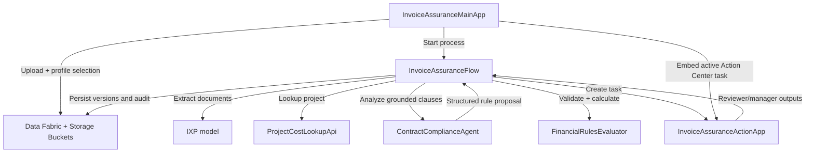

# Solution Design Document — Healthcare Invoice Assurance

## Document History

| Date | Version | Author | Role | Comments |
|---|---|---|---|---|
| 2026-08-07 | 1.0 | Codex | Generated by AI Agent | Initial architecture approved interactively |

<!-- DO NOT RENAME: uipath-planner detects SDDs via this exact heading or the marker below. -->
<!-- planner-handoff:v1 -->
## Planner Handoff

| Field | Value |
|---|---|
| **Execution autonomy** | interactive |
| **Delivery model** | cloud |
| **SDD scope** | solution |
| **Project list section** | §2 Project Inventory |
| **Tasks file** | `healthcare-invoice-assurance-tasks.md` |
| **Generated by** | uipath-planner |
| **Generation date** | 2026-08-07 |

**Cross-project ordering:** establish shared data/document resources first; build callable Agent, Function, and API Workflow before binding them into the Flow; deploy the Action App before configuring Flow AppTasks; deploy the Main App after runtime identifiers and OAuth scopes are known.

## Recommended Scope

**Recommendation:** Solution(Maestro Flow, Agent, Coded Web App, Coded Action App, Coded Function, API Workflow)

**Delivery model:** cloud

**Blocked by platform:** none

## 1. Solution Overview

### Objective

Provide a reusable, evidence-led invoice assurance workflow that analyzes uploaded invoices and receipts against a selected indexed contract family, calculates adjustments deterministically, and routes review and approval through embedded Action Center tasks.

### Business context

The solution demonstrates an Office of the CFO control for healthcare project invoices. It emphasizes contract compliance, supporting evidence, explainable exceptions, and a complete audit trail. It does not depend on PO matching or a live ERP.

### In scope

- Live upload and submission from a Coded Web App.
- IXP classification and extraction.
- Mock project-cost reconciliation.
- Effective contract-stack analysis using Context Grounding.
- Generic deterministic financial evaluation.
- Reviewer and Manager Action Center tasks.
- Single-pane task embedding.
- Evidence upload and targeted re-evaluation.
- Data Fabric records, Storage Buckets, audit history, and operational KPIs.

### Out of scope

- Case Management stages.
- Live ERP posting or payment release.
- Live supplier email or portal exchange.
- Production identity design.
- PHI processing.
- Fraud, legal, or misconduct conclusions.
- Hard-coded findings or seeded financial outcomes.

## 2. Project Inventory

| # | Project | Product | Role | Packaging |
|---|---|---|---|---|
| 1 | `InvoiceAssuranceFlow` | Maestro Flow | Linear orchestration, live status, HITL routing, re-evaluation loop | Registered in `.uipx` |
| 2 | `ContractComplianceAgent` | Low-code autonomous Agent | Grounded clause applicability and structured rule proposals | Registered in `.uipx` |
| 3 | `InvoiceAssuranceMainApp` | Coded Web App | Intake, portfolio, progress, case workspace, embedded tasks | Independent Coded App deployment |
| 4 | `InvoiceAssuranceActionApp` | Coded Action App | Reusable Reviewer and Manager task surface | Independent Coded App deployment |
| 5 | `FinancialRulesEvaluator` | Python Coded Function | Deterministic rule validation, calculations, and financial snapshots | Published callable package; solution-bound resource |
| 6 | `ProjectCostLookupApi` | API Workflow | Deterministic mock project-cost lookup | Registered in `.uipx` |

### Supporting platform resources

| Resource | Purpose |
|---|---|
| Contract Storage Bucket | Pre-hosted fictional agreements and amendments |
| Case Document Storage Bucket | Uploaded invoices, receipts, and evidence responses |
| Context Grounding index | Contract retrieval for the selected Contract Profile |
| Data Fabric entities | Structured case, charge, finding, decision, and audit records |
| IXP project/model | Invoice and receipt classification and extraction |
| Reviewer group | Reviewer Action Center task assignment |
| Manager group | Final approval task assignment |

## 3. Cross-Project Data Flow

### Shared identifiers

All boundaries carry:

- `correlationId`.
- `assuranceCaseId`.
- `processInstanceId` when available.
- `contractProfileId`.
- `analysisRunId`.
- Source-document and task identifiers relevant to the call.

### Runtime sequence

1. The Main App validates upload and profile selection.
2. Documents are stored and the case record is created.
3. The Main App starts `InvoiceAssuranceFlow`.
4. Flow invokes IXP and normalizes extraction output.
5. Flow invokes `ProjectCostLookupApi`.
6. Flow invokes `ContractComplianceAgent` with charges, invoice date, profile, and index binding.
7. Flow invokes `FinancialRulesEvaluator` with canonical charges and normalized proposed rules.
8. Flow creates the Reviewer AppTask.
9. Reviewer work remains pending while evidence is collected and saved.
10. On submit, Flow persists decisions and invokes targeted re-evaluation.
11. A failed evidence gate loops to another Reviewer AppTask; a passed gate advances to Manager approval.
12. Final outcome and financial snapshot are stored.

## 4. Shared Data Definitions

| Entity | Key fields | Ownership |
|---|---|---|
| Contract Profile | profile ID, account/project mapping, index ID, precedence policy, groups, tolerances | Data Fabric configuration |
| Assurance Case | case ID, correlation ID, invoice metadata, current workflow status, financial snapshot | Flow/Data Fabric |
| Source Document | document ID, checksum, type, bucket path, version, provenance | Main App/Flow |
| Analysis Run | run ID, input versions, context stack, agent version, evaluator version, status | Flow |
| Charge | charge ID, category, dates, quantity, submitted amount, supporting-document references | IXP/normalization |
| Finding | finding ID, rule type, affected charges, proposed effect, state, citations, confidence | Agent/Function |
| Evidence Request | request ID, finding ID, notes, evidence document ID, status | Reviewer Action App |
| Human Decision | decision ID, role, action, correction, rationale, timestamp | Action Center/Flow |
| Audit Event | event ID, actor, source component, event type, before/after references | All components through Flow |

### Data ownership rules

- Data Fabric is the structured system of record.
- Storage Buckets are the binary system of record.
- Maestro owns process state, not the long-term business record.
- Source documents are immutable; revisions create new versions.
- Each analysis and calculation creates a new versioned snapshot.
- Evaluation expected values never enter runtime records.

## 5. Shared Assets and Queues

### Assets

| Asset/configuration | Consumer | Notes |
|---|---|---|
| Contract Profile mapping | Main App, Flow, Agent | No client names in reusable flow logic |
| Contract index binding | Agent | One profile resolves one indexed contract family |
| Reviewer/Manager groups | Flow | Same demo user may belong to both; production identities remain separate |
| Retry and timeout policy | Flow, Agent, API Workflow | `[DEFAULT]` bounded retry; no silent answer-key fallback |

### Queues

No Orchestrator queue is required for the primary live path. The solution is one long-running Maestro instance per submitted package. A queue may be introduced later for bulk intake without changing the business model.

## 6. Security and Trust Boundaries

- Use Automation Cloud authentication and least-privilege OAuth scopes.
- The Main App displays only cases and tasks the signed-in user can access.
- Embedded Action Center relies on the existing UiPath browser session.
- The Agent has read access only to the selected contract index and supplied analysis input.
- The Agent cannot write final monetary values directly.
- The Coded Function contains no LLM calls.
- The Demo Guide and answer key are excluded from all runtime indexes and prompts.
- All documents are fictional and must contain no PHI.

## 7. Error and Recovery Model

| Condition | System behavior |
|---|---|
| Duplicate upload | Reject or return existing case using package fingerprint |
| Missing invoice/profile | Block submission with Apollo inline validation |
| Low extraction confidence | Add reviewer-visible validation finding |
| Project record absent | Return `NotFound`; do not represent as technical failure |
| Project search incomplete | Return `SearchIncomplete`; allow retry/escalation |
| Ambiguous clause | Produce non-monetary reviewer finding; no automatic deduction |
| Invalid Agent schema | Bounded retry, then technical-review finding |
| Invalid financial rule | Function returns typed validation errors; no financial snapshot promoted |
| Insufficient evidence | Route back to Reviewer task after re-evaluation |
| Manager returns review | Route back to Reviewer task with manager rationale |
| Task embed failure | Show retryable inline error while preserving task and workflow state |

## 8. Evaluation and Testing Strategy

### Canonical fixture

The supplied fictional package is an evaluation fixture with an external expected-results guide. Runtime components cannot access that guide.

### Required evaluation classes

- Canonical fixture accuracy.
- Mutated invoice amounts and quantities.
- Different invoice under the same contract.
- Fully compliant invoice.
- Missing and contradictory evidence.
- Contract precedence and effective-date variations.
- Agent schema validation and ambiguity behavior.
- Deterministic calculation unit tests.
- Reviewer evidence loop and Manager return loop.
- Single-pane embedded-task behavior.
- Idempotent submission and reset.
- Apollo accessibility, contrast, focus, loading, overflow, and responsive behavior.

### Demo success conditions

- Live path completes within the 8–10 minute presentation.
- Seeded fixture results are independently derived, not memorized.
- A different supported invoice can produce different findings.
- Every monetary finding has grounded evidence and a deterministic trace.
- Targeted re-evaluation changes only the affected finding.
- Full original and revised analysis history remains auditable.

## 9. Source-Pack Corrections

Before build evaluation:

1. Add explicit meal pre-approval to the fictional project addendum.
2. Clarify invoice/register tie-out and per-subcontract-document matching.

These corrections preserve generic runtime behavior and must not be encoded as exceptions in prompts or code.

## 10. Per-Project SDD Index

| Project | SDD | Scope |
|---|---|---|
| InvoiceAssuranceFlow | [invoice-assurance-flow-sdd.md](invoice-assurance-flow-sdd.md) | Linear orchestration and HITL routing |
| ContractComplianceAgent | [contract-compliance-agent-sdd.md](contract-compliance-agent-sdd.md) | Grounded contract reasoning |
| InvoiceAssuranceMainApp | [invoice-assurance-main-app-sdd.md](invoice-assurance-main-app-sdd.md) | Single-pane operating interface |
| InvoiceAssuranceActionApp | [invoice-assurance-action-app-sdd.md](invoice-assurance-action-app-sdd.md) | Reviewer and Manager tasks |
| FinancialRulesEvaluator | [financial-rules-evaluator-sdd.md](financial-rules-evaluator-sdd.md) | Deterministic financial rules |
| ProjectCostLookupApi | [project-cost-lookup-api-sdd.md](project-cost-lookup-api-sdd.md) | Mock project-cost adapter |

## 11. Next Steps

This SDD set is architecture only. If implementation is requested later, load `uipath-planner` with this file to derive a separate task list. Do not create, publish, or deploy UiPath assets from this document alone.
