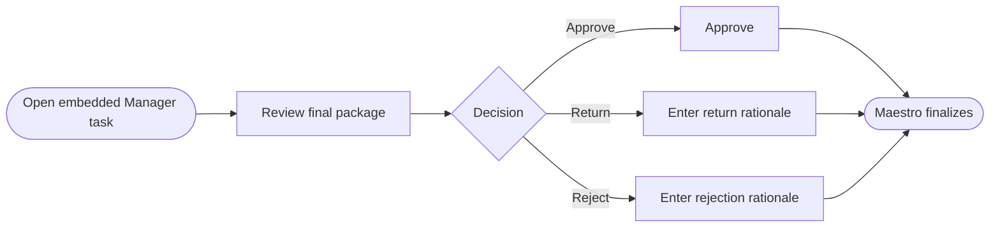

# Solution Design Document — InvoiceAssuranceActionApp

## Document History

| Date | Version | Author | Role | Comments |
|---|---|---|---|---|
| 2026-08-07 | 1.0 | Codex | Generated by AI Agent | Initial interactive SDD |
| 2026-08-08 | 1.1 | Codex | Generated by AI Agent | Added approved task folder and evidence bucket bindings |
| 2026-08-08 | 1.2 | Codex | Generated by AI Agent | Aligned task context and persistence to the three-entity demo data model |
| 2026-08-08 | 1.3 | Codex | Generated by AI Agent | Required folder-scoped Data Fabric access in `AMER Presales/HLS` |

<!-- DO NOT RENAME: uipath-planner detects SDDs via this exact heading or the marker below. -->
<!-- planner-handoff:v1 -->
## Planner Handoff

| Field | Value |
|---|---|
| **Execution autonomy** | interactive |
| **Delivery model** | cloud |
| **SDD scope** | solution |
| **Project list section** | §10 Project Structure + §9 Integrated Components |
| **Tasks file** | `invoice-assurance-action-app-tasks.md` |
| **Generated by** | uipath-planner |
| **Generation date** | 2026-08-07 |

## Recommended Scope

**Recommendation:** Solution(Maestro Flow, Agent, Coded Apps, Coded Function, API Workflow)

**Delivery model:** cloud

**Blocked by platform:** none

## Table of Contents

1. App Overview
2. App Type & Tech Stack
3. Pages & Routes
4. Components
5. State Management
6. API Integration
7. User Flows
8. Error Handling
9. Integrated Components
10. Project Structure
11. Testing Strategy
12. Next Steps

## 1. App Overview

| Field | Value |
|---|---|
| **App name** | InvoiceAssuranceActionApp |
| **Objective** | Provide one reusable, evidence-led human task interface for Reviewer and Manager work |
| **Primary users** | Invoice Reviewer, Manager Approver |
| **Trigger** | AppTask created by `InvoiceAssuranceFlow` and rendered by Action Center |
| **Expected concurrent users** | Demo-grade; one actor per claimed task |

### In Scope

- Reviewer and Manager modes selected by task input.
- Structured findings, charges, evidence, and contract citations.
- Reviewer correction and evidence collection.
- Save/reopen pending Reviewer task.
- Manager approval, return, or rejection.
- Task output that resumes the linear Maestro Flow.
- Apollo-first UI consistent with the Main App.

### Out of Scope

- Standalone navigation outside Action Center.
- Starting the Maestro Flow.
- Direct financial calculation of record.
- Uploading contract/amendment documents.
- Live supplier email or portal interaction.
- Case Management stage transitions.

## 2. App Type & Tech Stack

### App Type

- **Action:** Coded Action App hosted inside Action Center AppTasks.

### Tech Stack

| Layer | Selection |
|---|---|
| Framework | React + TypeScript |
| Build tool | Vite |
| UiPath SDK | `@uipath/uipath-typescript` using the Action Center host-injected session |
| Primary design system | `@uipath/apollo-wind` + `@uipath/apollo-core` |
| Styling | Apollo semantic tokens; restrained UiPath brand accents |
| Document rendering | JavaScript PDF renderer compatible with Action Center sandboxing |

The Action App must construct the UiPath SDK without initiating the Web App PKCE flow. It must not call SDK initialization that causes a browser redirect.

Native browser PDF `<embed>`, `<object>`, or nested PDF `<iframe>` rendering is not used inside the Action App because Action Center sandboxing blocks those approaches.

## 3. Pages & Routes

An Action App has one hosted work surface rather than standalone routes.

| Route/Mode | Page Name | Purpose | Who Sees It |
|---|---|---|---|
| Hosted `Reviewer` mode | Review workspace | Review findings, correct reconciliation, track evidence, upload receipt, and submit | Reviewer |
| Hosted `Manager` mode | Approval workspace | Review final package and choose disposition | Manager |

Mode comes from trusted task input and is not selected by an unrestricted UI toggle.

## 4. Components

| Component Name | Type | Used On Pages | Purpose |
|---|---|---|---|
| `ActionAppShell` | Layout | Both | Task identity, role label, status, and responsive work area |
| `ReviewSummary` | Summary | Both | Invoice/project totals, current analysis version, and status |
| `FindingList` | Structured list | Both | Findings, financial effect, status, confidence, and disposition |
| `ChargeDetail` | Table/panel | Reviewer | Charge-level submitted/allowed/adjusted values and source references |
| `ClauseEvidence` | Evidence panel | Both | Governing document, clause, excerpt summary, and applicability explanation |
| `RegisterCorrection` | Editable form | Reviewer | Correct structured register amount with required reason |
| `EvidenceTracker` | Status/form | Reviewer | Record request notes and `Awaiting Evidence` status |
| `EvidenceUpload` | File input | Reviewer | Upload collected PPE receipt to the invoice package bucket |
| `DocumentViewer` | PDF viewer | Both | Render invoice/receipt documents with paging and zoom |
| `AuditPreview` | Timeline | Both | Relevant prior analysis, corrections, evidence, and decisions |
| `ReviewerActions` | Action bar | Reviewer | Save and Exit; Submit Review |
| `ManagerActions` | Action bar | Manager | Approve; Return to Reviewer; Reject |

The first viewport is a working review surface, not a marketing hero. Panels remain flat and scannable, with the primary decision state visible without excessive card nesting.

## 5. State Management

### Global State

| State Slice | Type | Purpose |
|---|---|---|
| Task context | Data | Task ID, mode, `invoiceRecordId`, correlation ID, analysis version |
| Review data | Data | Findings, charges, citations, documents, reviewer edits, evidence references |
| Completion state | UI/Data | Save status, validation, selected outcome, submit status |

### Local Component State

- Correction editor holds draft value/reason until persisted to task data.
- Evidence uploader holds file progress and retry state.
- Tables and viewers hold pagination/zoom/tab state.
- Outcome confirmation dialogs hold only transient UI state.

### Persistence behavior

- Every meaningful Reviewer edit updates Action Center task data so closing the task does not lose progress.
- `Save and Exit` leaves the task pending.
- Evidence files are stored in `healthcare-invoice-assurance-uploadedInvoices`; task data stores immutable references and metadata.
- `Submit Review` validates required correction reasons and evidence references before completing the task.
- Manager outcomes complete the task with a structured decision and optional/required rationale according to outcome.

## 6. API Integration

| Backend | Type | Purpose | Auth |
|---|---|---|---|
| Action Center host service | Coded Action App service | Read/persist task data and complete outcome | Host-injected session |
| Storage Bucket `healthcare-invoice-assurance-uploadedInvoices` | UiPath SDK | Upload evidence and retrieve document bytes | Host-injected session |
| Data Fabric in `AMER Presales/HLS` | UiPath SDK or Flow-owned snapshot input | Retrieve the folder-scoped `HLS_InvoiceAssurance_Main`, affected `HLS_InvoiceAssurance_LineItems`, and relevant `HLS_InvoiceAssurance_Activity` data when not fully provided in task input; do not resolve tenant-scoped equivalents | Host-injected session with task folder context |

### UiPath API Workflow Calls

None. The Action App returns structured work to Maestro. It does not invoke project reconciliation or financial analysis directly.

### Business input/output contract

Reviewer mode receives the latest analysis snapshot, findings, source references, and existing review data. It returns corrections, evidence references, finding dispositions, notes, and the `SubmitReview` outcome.

Manager mode receives the final review package and returns `Approve`, `ReturnToReviewer`, or `Reject`, plus rationale where required.

Exact `action-schema.json` field names and bindings are implementation-owned and must be confirmed against the final Flow variables before authoring.

## 7. User Flows

### Flow: Reviewer follows up and submits evidence

```mermaid
flowchart LR
    Start(["Open embedded Reviewer task"]) --> Review["Review findings and evidence"]
    Review --> Correct["Correct register and enter reason"]
    Correct --> Request["Record PPE follow-up"]
    Request --> Save["Save and exit while waiting"]
    Save --> Reopen["Reopen same pending task"]
    Reopen --> Upload["Upload collected PPE receipt"]
    Upload --> Submit["Submit Review"]
    Submit --> End(["Maestro resumes"])
```



### Flow: Manager decides final outcome



## 8. Error Handling

| Error Scenario | User-Facing Behavior | Logging |
|---|---|---|
| Task input invalid | Blocking Apollo alert; disable completion | Task/correlation-aware client error |
| Task data save fails | Preserve local edits; show retryable status | Structured task persistence error |
| Evidence upload fails | Preserve selected file metadata; retry upload | Bucket/correlation error without file contents |
| Unsupported file | Inline validation before upload | Client validation event |
| Correction reason missing | Inline field error; block Submit Review | No platform error needed |
| Task already completed | Read-only completed state and refresh instruction | Task status diagnostic |
| Document download fails | Keep decision surface usable; show document retry | Structured document error |
| Completion fails | Keep edits and outcome; allow retry without duplicate decision | Task completion error |
| Session unavailable | Show host-session error; do not initiate standalone OAuth redirect | Authentication diagnostic |

## 9. Integrated Components

### Called By (if Action app)

| Caller | Type | Context |
|---|---|---|
| `InvoiceAssuranceFlow.reviewerTask` | Flow HITL AppTask | Reviewer works findings and evidence before submitting |
| `InvoiceAssuranceFlow.managerTask` | Flow HITL AppTask | Manager provides final disposition |

### HITL Form Role

- This app is the HITL form renderer for both Flow touchpoints.
- `taskMode` controls Reviewer versus Manager behavior.
- Task completion resumes the Flow through its `completed` path.
- Demo tasks are created unassigned; any eligible user with folder and task access can claim one before acting.

### Embedded host

The Main Web App embeds the correlated Action Center task. The Action App remains hosted by Action Center and inherits its authenticated session and task lifecycle.

## 10. Project Structure

```text
InvoiceAssuranceActionApp/
├── src/
│   ├── components/
│   ├── services/
│   ├── models/
│   ├── styles/
│   └── App.tsx
├── public/
├── action-schema.json
├── uipath.json
├── package.json
├── vite.config.ts
├── postcss.config.js
└── dist/
```

### Deployment Target

- Independently packaged and published as type `Action`.
- Hosted by unassigned Action Center tasks created in `uipathlabs / Playground`, folder `AMER Presales/HLS` (numeric folder ID `2036001`; GUID/key `79d872b0-bee1-4264-a6de-3e780f4e4239`).
- Deployed before Flow AppTask resource binding is finalized.
- Logically part of the solution but not registered in the `.uipx`.

## 11. Testing Strategy

### Canonical Test Cases

| Test ID | User Flow | Input | Expected Outcome |
|---|---|---|---|
| AA-01 | Reviewer initial work | Canonical runtime-derived analysis | Findings render with citations; no expected values are hard-coded |
| AA-02 | Save/reopen | Register correction and evidence-request note | Same pending task restores edits |
| AA-03 | Evidence upload | Valid prepared PPE receipt | Bucket reference persists in task output |
| AA-04 | Reviewer submit | Valid correction reason and evidence reference | Task completes once with `SubmitReview` |
| AA-05 | Manager approve | Final runtime-derived package | Task completes with `Approve` |
| AA-06 | Manager return | Return rationale | Flow receives return decision and reason |

### Unit Tests

- Mode-based component visibility and outcomes.
- Required rationale and evidence validation.
- Task-data persistence behavior.
- Upload state and retry handling.
- Document viewer paging/zoom/error behavior.
- Apollo semantic states and theme compatibility inside Action Center.

### E2E Tests

- Reviewer saves, closes, reopens, uploads evidence, and submits from the Main App embed.
- Manager completes each outcome from the same embedded surface.
- Double-submit protection prevents duplicate task completion.
- Document viewer works inside the Action Center sandbox without native PDF embedding.
- Keyboard-only operation, focus order, contrast, text overflow, loading, and responsive behavior pass.

## 12. Next Steps

This SDD captures architecture only. If implementation is authorized later, load `uipath-planner` with this file or the solution overview to derive a separate task list. No Action App asset is created by this document.
