# Solution Design Document — InvoiceAssuranceFlow

## Document History

| Date | Version | Author | Role | Comments |
|---|---|---|---|---|
| 2026-08-07 | 1.0 | Codex | Generated by AI Agent | Initial interactive SDD |
| 2026-08-08 | 1.1 | Codex | Generated by AI Agent | Added approved solution and folder deployment target |
| 2026-08-08 | 1.2 | Codex | Generated by AI Agent | Bound the prepared IXP project and added model-readiness requirements |
| 2026-08-08 | 1.3 | Codex | Generated by AI Agent | Aligned persistence to the three-entity demo Data Fabric model |
| 2026-08-08 | 1.4 | Codex | Generated by AI Agent | Required folder-scoped Data Fabric bindings in `AMER Presales/HLS` |
| 2026-08-09 | 1.5 | Codex | Generated by AI Agent | Added the approved Studio Web persistence helper required for folder-level entities |

<!-- DO NOT RENAME: uipath-planner detects SDDs via this exact heading or the marker below. -->
<!-- planner-handoff:v1 -->
## Planner Handoff

| Field | Value |
|---|---|
| **Execution autonomy** | interactive |
| **Delivery model** | cloud |
| **SDD scope** | solution |
| **Project list section** | §3 Nodes Inventory + §7 Integrated Components |
| **Tasks file** | `invoice-assurance-flow-tasks.md` |
| **Generated by** | uipath-planner |
| **Generation date** | 2026-08-07 |

## Recommended Scope

**Recommendation:** Solution(Maestro Flow, RPA Process, Agent, Coded Apps, Coded Function, API Workflow)

**Delivery model:** cloud

**Blocked by platform:** none

## Table of Contents

1. Flow Overview
2. Flow Diagram
3. Nodes Inventory
4. Variables
5. Subflows
6. Triggers
7. Integrated Components
8. Error Handling
9. Project Structure
10. Testing Strategy
11. Next Steps

## 1. Flow Overview

| Field | Value |
|---|---|
| **Flow name** | InvoiceAssuranceFlow |
| **Objective** | Orchestrate one uploaded invoice package from extraction through final human approval |
| **Department / Function** | Finance — Invoice assurance |
| **Trigger type** | Process invocation from the Main Coded Web App |
| **Expected execution volume** | Demo-grade; one live package per presentation, reusable for higher volume later |

### In Scope

- Validate a submitted package reference and Contract Profile.
- Invoke IXP extraction.
- Invoke the mock project-cost lookup.
- Invoke the grounded contract-analysis Agent.
- Invoke deterministic financial evaluation.
- Create Reviewer and Manager AppTasks.
- Persist versioned analysis, decision, and audit records.
- Loop back to Reviewer when post-review evidence remains insufficient.

### Out of Scope

- Case Management stages or discretionary case tasks.
- Live supplier communication.
- ERP posting or payment release.
- Hard-coded scenario findings or financial values.
- Direct contract-document upload during review.

## 2. Flow Diagram

```mermaid
flowchart LR
    Start(["Start from Main App"]) --> Validate["Validate submission"]
    Validate --> Extract["IXP extract package"]
    Extract --> Reconcile["Project-cost lookup"]
    Reconcile --> Analyze["Grounded contract analysis"]
    Analyze --> Calculate["Deterministic evaluation"]
    Calculate --> Reviewer["Reviewer AppTask"]
    Reviewer --> Persist["Persist review and evidence"]
    Persist --> Reevaluate["Targeted re-evaluation"]
    Reevaluate --> Ready{"Ready for approval?"}
    Ready -->|No| Reviewer
    Ready -->|Yes| Manager["Manager AppTask"]
    Manager --> Outcome{"Outcome"}
    Outcome -->|Return| Reviewer
    Outcome -->|Approve or reject| Finalize["Record final disposition"]
    Finalize --> End([End])
```



The process stays at the Reviewer AppTask while the reviewer follows up and collects evidence. `AwaitingEvidence` is stored on a finding/evidence request and shown in the UI; it is not a separate Flow stage.

## 3. Nodes Inventory

| # | Node Key | Node Type | Description | Inputs | Outputs | Notes |
|---|---|---|---|---|---|---|
| 1 | `startAnalysis` | Trigger | Accept a submitted invoice record | invoice record ID, correlation ID | submission context | Called by Main App |
| 2 | `validateSubmission` | Logic | Confirm invoice record, documents, and Contract Profile exist | submission context | validated context | Fail before external calls |
| 3 | `markProcessing` | Transform + synchronous process invocation | Prepare the status/activity payload and invoke `InvoiceAssurancePersistence` | invoice record ID | persisted status result | Folder-scoped write; append-only activity |
| 4 | `extractPackage` | IXP | Classify and extract the primary invoice, subcontractor invoices, receipts, and cost register | document references | extraction result | Bind to a published model from `healthcare-invoice-assurance-51392a38-ixp` after taxonomy validation and folder availability |
| 5 | `normalizeCharges` | Transform | Convert extraction into canonical charges/documents | extraction result | canonical package | Preserve source coordinates and confidence |
| 6 | `lookupProjectCost` | API Workflow invocation | Validate supplier, project, invoice, and register data | canonical package, profile | reconciliation result | No PO matching |
| 7 | `contractGovernedGate` | Logic | Confirm selected profile has an eligible indexed contract family | profile, invoice date | governed/unavailable | Unavailable becomes reviewer-visible technical item |
| 8 | `analyzeContract` | Agent invocation | Resolve effective contract stack and propose grounded rules/findings | charges, date, profile, reconciliation | structured analysis | Low-code autonomous Agent |
| 9 | `evaluateFinancials` | Service task | Validate rules and calculate authoritative amounts | charges, structured analysis | evaluation result | Python Coded Function; no LLM |
| 10 | `persistInitialAnalysis` | Transform + synchronous process invocation | Prepare the initial snapshot and invoke `InvoiceAssurancePersistence` to update Main, upsert LineItems, and append Activity | evaluation result | analysis version ID | Initial snapshot is versioned |
| 11 | `reviewerTask` | HITL AppTask | Reviewer corrects reconciliation, records evidence follow-up, uploads evidence, and submits | analysis version, findings, documents | reviewer decision, corrections, evidence | Reusable Coded Action App in Reviewer mode; created unassigned for claim from Action Center |
| 12 | `persistReviewerWork` | Transform + synchronous process invocation | Prepare the reviewer delta and invoke `InvoiceAssurancePersistence` to update affected values and append activity | task output | updated invoice references | Task may be saved without completion by Action Center |
| 13 | `reevaluateAffectedFindings` | Subflow | Re-run only findings affected by new evidence or an override | prior version, changed inputs | new analysis version | Unaffected findings retain identity/version lineage |
| 14 | `approvalReadinessGate` | Logic | Decide whether required review items are resolved | latest findings | ready/not ready | Not ready creates a new Reviewer AppTask |
| 15 | `managerTask` | HITL AppTask | Manager approves, returns, or rejects | final review package | manager decision | Same Action App in Manager mode; created unassigned for claim from Action Center |
| 16 | `routeManagerOutcome` | Logic | Route return, approval, or rejection | manager decision | route | Return includes manager rationale |
| 17 | `finalizeOutcome` | Transform + synchronous process invocation | Prepare the final snapshot and invoke `InvoiceAssurancePersistence` to update Main and append the disposition activity | latest analysis, decision | finalized invoice | No ERP post |
| 18 | `end` | End | Complete process instance | finalized invoice | — | — |

## 4. Variables

| Name | Direction | Type | Default | Description |
|---|---|---|---|---|
| `invoiceRecordId` | IN | string | — | `HLS_InvoiceAssurance_Main` system identifier |
| `correlationId` | INOUT | string | generated at submission | Cross-component correlation identifier |
| `contractProfileId` | IN | string | — | Selected account/project contract profile |
| `sourceDocumentIds` | IN | array[string] | `[]` | Uploaded invoice and receipt document IDs |
| `processInstanceId` | OUT | string | runtime | Maestro instance identifier |
| `canonicalPackage` | INOUT | object | `{}` | Normalized invoice, receipts, register, and charges |
| `reconciliationResult` | INOUT | object | `{}` | Supplier/project/invoice/register lookup result |
| `contractAnalysis` | INOUT | object | `{}` | Structured Agent output with citations |
| `analysisVersion` | INOUT | integer | `0` | Latest persisted analysis version |
| `reviewerDecision` | INOUT | object | `{}` | Reviewer task output |
| `managerDecision` | OUT | object | `{}` | Manager task outcome |
| `technicalErrors` | INOUT | array[object] | `[]` | Typed recoverable and terminal errors |

## 5. Subflows

| Subflow Name | Purpose | Inputs | Outputs | Called From Nodes |
|---|---|---|---|---|
| `RecordActivityEvent` | Prepare a normalized `HLS_InvoiceAssurance_Activity` event and pass it to the persistence helper without duplicating timeline logic | invoice record ID, actor, event type, references, payload | activity ID | All state-changing nodes |
| `PersistAnalysisVersion` | Prepare the current Main/LineItems snapshot and invoke `InvoiceAssurancePersistence`, which performs the folder-scoped writes | analysis/evaluation outputs | analysis version ID | `persistInitialAnalysis`, `reevaluateAffectedFindings` |
| `ReevaluateAffectedFindings` | Select changed findings, invoke analysis/evaluation as needed, and preserve unaffected lineage | prior version, evidence/override delta | new version, readiness | `reevaluateAffectedFindings` |

Subflows are reusable units inside one top-level Maestro Flow; they are not separate case stages.

## 6. Triggers

| Trigger Type | Configuration | Notes |
|---|---|---|
| Process invocation | Main App submits `invoiceRecordId`, `correlationId`, and `contractProfileId` | The Main App uploads documents before starting the process |

No email, schedule, or watched-folder trigger is required for the primary demo.

## 7. Integrated Components

### RPA Processes Invoked

| Process | Called From | Purpose |
|---|---|---|
| `InvoiceAssurancePersistence` | `markProcessing`, `persistInitialAnalysis`, `persistReviewerWork`, `reevaluateAffectedFindings`, `finalizeOutcome` | Synchronously execute native Data Service activities against the three approved folder-level entities; required because Maestro and connector activities do not support folder-level entities |

The process is a narrow product-surface adapter documented in [invoice-assurance-persistence-sdd.md](invoice-assurance-persistence-sdd.md). It contains no business decisions or financial calculations.

### Agents Invoked

| Agent Name | Called From Node | Purpose |
|---|---|---|
| `ContractComplianceAgent` | `analyzeContract` and targeted re-evaluation | Resolve effective clauses and propose structured rules/findings |

### API Workflows Invoked

| API Workflow Name | Called From Node | Purpose |
|---|---|---|
| `ProjectCostLookupApi` | `lookupProjectCost` | Deterministic mock supplier/project/register lookup |

### Integration Service Connectors

None required for the primary demo. In particular, the Data Fabric Integration Service connector is not used for persistence because it cannot address folder-level entities.

### IXP model

| Project | Called From Node | Required Runtime State |
|---|---|---|
| `Healthcare Invoice Assurance` (`healthcare-invoice-assurance-51392a38-ixp`, ID `43a0c85c-5d97-80f8-9f1f-2ac01bae3742`) | `extractPackage` | Taxonomy configured and evaluated; model version published and made available to `AMER Presales/HLS`; Flow resource binding resolved |

The current project shell is not yet consumable by the Flow: model version `0` is unpinned and the taxonomy contains no extraction fields. The Flow build may add the IXP node only after the published model appears in the tenant registry; it must not substitute an unrelated OOTB invoice model silently.

### HITL Touchpoints

| Node Key | HITL Type | Purpose | Approval Criteria |
|---|---|---|---|
| `reviewerTask` | AppTask | Review findings, correct register, collect evidence, submit review | Reviewer declares package ready and supplies required rationale/evidence |
| `managerTask` | AppTask | Final independent disposition | Manager chooses Approve, Return, or Reject |

### Coded Apps Referenced

| App Name | Called From Node | Role |
|---|---|---|
| `InvoiceAssuranceActionApp` | `reviewerTask`, `managerTask` | Reusable HITL renderer with task mode input |
| `InvoiceAssuranceMainApp` | External caller/observer | Starts the Flow, monitors it, and embeds active tasks |

### Other callable component

| Component | Called From Node | Purpose |
|---|---|---|
| `FinancialRulesEvaluator` | `evaluateFinancials`, targeted re-evaluation | Typed deterministic financial evaluation |

## 8. Error Handling

| Scope | Error Type | Trigger | Action |
|---|---|---|---|
| Flow | Invalid submission | Missing invoice record/profile/document reference | Mark submission failed; do not invoke analysis |
| IXP | Low-confidence extraction | Required field below configured confidence | Create reviewer-visible validation finding |
| IXP | Extraction failure | Model/runtime error | Bounded retry, then technical-review item |
| API Workflow | `NotFound` | Valid search completes with no project record | Continue with business finding; do not label technical failure |
| API Workflow | `SearchIncomplete` | Mock/system search cannot complete | Retry according to policy; then technical-review item |
| Agent | Invalid output schema | Missing citations/rule operands or malformed structure | Bounded retry; then non-monetary technical finding |
| Function | Invalid rule/calculation | Unsupported type, missing operand, inconsistent totals | Reject snapshot and route to review; never guess |
| HITL | Insufficient evidence | Post-review re-evaluation does not clear required item | Create new Reviewer task |
| HITL | Manager return | Manager selects Return | Route to Reviewer with rationale |
| Flow | Duplicate start | Existing fingerprint/correlation detected | Return existing invoice/process reference |
| Persistence helper | Invalid or oversized payload | Required identifier/field missing, unsupported operation, or text exceeds the approved entity limit | Fail before any write and return a typed error to Maestro |
| Persistence helper | Partial write/system failure | Native Data Service activity fails | Return a typed failure; Maestro records/routes the technical failure and never reports success |
| Flow | Unhandled exception | Any terminal node failure | Persist failure and audit event; do not delete partial evidence |

## 9. Project Structure

```text
HealthcareInvoiceAssurance/
├── HealthcareInvoiceAssurance.uipx
├── InvoiceAssuranceFlow/
    ├── project.json
    ├── InvoiceAssuranceFlow.flow
    ├── entry-points.json
    ├── bindings_v2.json
    └── content/
        └── InvoiceAssuranceFlow.bpmn
└── InvoiceAssurancePersistence/
    ├── project.json
    ├── Main.xaml
    └── .entities/
        └── EntitiesStore.json
```

### Orchestrator Deployment Target

- Studio Web solution `Healthcare Invoice Assurance` for authoring and validation.
- Automation Cloud organization `uipathlabs`, tenant `Playground`.
- Orchestrator folder `AMER Presales/HLS` (numeric folder ID `2036001`; GUID/key `79d872b0-bee1-4264-a6de-3e780f4e4239`).
- Bind `HLS_InvoiceAssurance_Main`, `HLS_InvoiceAssurance_LineItems`, and `HLS_InvoiceAssurance_Activity` from this folder only. Do not bind tenant-scoped or same-named entities from another folder.
- `InvoiceAssurancePersistence` must remain inside this Solution and use native Data Service activities with folder scope; a standalone project or Data Fabric connector substitution is not acceptable.
- Automation Cloud/Orchestrator deployment through the `.uipx` solution lifecycle.
- Coded Apps remain independently deployed and referenced as solution resources.

## 10. Testing Strategy

### Canonical Test Case

| Input Variable | Value |
|---|---|
| `invoiceRecordId` | An `HLS_InvoiceAssurance_Main` record created from the supplied fictional package |
| `contractProfileId` | Fictional project Contract Profile mapped to the indexed contract family |
| `sourceDocumentIds` | Invoice and supplied receipt/support document IDs |

The external evaluation fixture contains expected findings and totals; those values are not embedded in the Flow.

### Happy Path Assertions

1. Submission progresses through live extraction, lookup, analysis, and evaluation.
2. The Reviewer task remains pending while evidence follow-up is recorded.
3. Reviewer corrections and evidence are versioned and auditable.
4. Targeted re-evaluation operates only on affected findings.
5. A resolved review advances to Manager approval.
6. Final approval persists an immutable final snapshot and disposition.
7. Main App can correlate and embed each active task by process instance.

### Error Path Scenarios

| Scenario | Setup | Expected Flow Behavior |
|---|---|---|
| Duplicate package | Submit identical document checksums twice | Second call returns existing invoice/process reference |
| Missing profile | Omit Contract Profile | Stop before extraction with typed validation error |
| Low extraction confidence | Degrade required invoice field prediction | Add reviewer validation finding |
| Ambiguous contract | Provide competing applicable clauses | No automatic deduction; Reviewer sees ambiguity |
| Agent schema failure | Return missing clause citation | Retry once according to policy, then route technical item |
| Insufficient PPE evidence | Upload unsupported document | Create another Reviewer task; preserve the prior analysis version in activity history |
| Manager return | Select Return with comment | Route to Reviewer and preserve Manager decision |
| Main App refresh | Reload during pending task | Process and task remain recoverable through IDs |

## 11. Next Steps

This SDD captures architecture only. If implementation is later authorized, load `uipath-planner` with this file or the solution overview to derive a separate task list. No Flow asset is created by this document.
