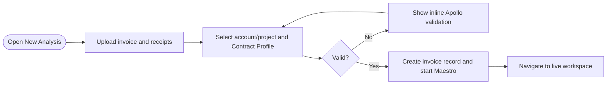
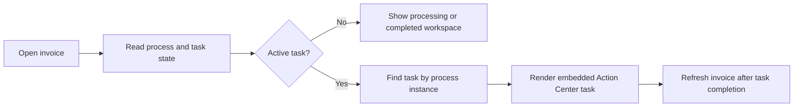

# Solution Design Document — InvoiceAssuranceMainApp

## Document History

| Date | Version | Author | Role | Comments |
|---|---|---|---|---|
| 2026-08-07 | 1.0 | Codex | Generated by AI Agent | Initial interactive SDD |
| 2026-08-08 | 1.1 | Codex | Generated by AI Agent | Added approved tenant, folder, solution, and bucket bindings |
| 2026-08-08 | 1.2 | Codex | Generated by AI Agent | Aligned the invoice workspace to the three-entity demo data model |
| 2026-08-08 | 1.3 | Codex | Generated by AI Agent | Required folder-scoped Data Fabric access in `AMER Presales/HLS` |

<!-- DO NOT RENAME: uipath-planner detects SDDs via this exact heading or the marker below. -->
<!-- planner-handoff:v1 -->
## Planner Handoff

| Field | Value |
|---|---|
| **Execution autonomy** | interactive |
| **Delivery model** | cloud |
| **SDD scope** | solution |
| **Project list section** | §10 Project Structure + §9 Integrated Components |
| **Tasks file** | `invoice-assurance-main-app-tasks.md` |
| **Generated by** | uipath-planner |
| **Generation date** | 2026-08-07 |

## Recommended Scope

**Recommendation:** Solution(Maestro Flow, Agent, Coded Apps, Coded Function, API Workflow)

**Delivery model:** cloud

**Blocked by platform:** none

## Table of Contents

1. App Overview
2. Environment Connection Details
3. App Type & Tech Stack
4. Pages & Routes
5. Components
6. State Management
7. API Integration
8. User Flows
9. Error Handling
10. Integrated Components
11. Project Structure
12. Testing Strategy
13. Next Steps

## 1. App Overview

| Field | Value |
|---|---|
| **App name** | InvoiceAssuranceMainApp |
| **Objective** | Provide one operational pane for intake, processing status, invoice review context, embedded human tasks, and final outcomes |
| **Primary users** | Invoice Reviewer, Manager Approver, demo presenter |
| **Trigger** | User navigates to the deployed Automation Cloud Coded Web App |
| **Expected concurrent users** | Demo-grade; architecture supports multiple authenticated users |

### In Scope

- Portfolio dashboard and recent-invoice list.
- New Analysis upload and Contract Profile selection.
- Live Maestro progress.
- Structured invoice workspace.
- Contract library metadata view.
- Embedded Action Center task for the selected process instance.
- Apollo light theme by default with dark-theme toggle.
- Empty states when no historical invoices have been seeded.

### Out of Scope

- Reimplementing Action Center task completion in the Web App.
- Chat-only review experience.
- Uploading new contract/amendment documents.
- Live supplier communications.
- ERP posting.
- Hard-coded dashboard metrics or expected findings.


## 2. Environment Connection Details

### Deployment target

| Setting | Approved value |
|---|---|
| Automation Cloud | `https://cloud.uipath.com/` |
| Organization | `uipathlabs` |
| Tenant | `Playground` |
| Orchestrator folder | `AMER Presales/HLS` |
| Numeric folder ID | `2036001` |
| Folder GUID/key | `79d872b0-bee1-4264-a6de-3e780f4e4239` |
| Data Fabric scope | Folder-scoped in `AMER Presales/HLS`; tenant-scoped entities are not used |
| Studio Web solution | `Healthcare Invoice Assurance` |
| Upload bucket | `healthcare-invoice-assurance-uploadedInvoices` |

Use the numeric folder ID only where the called API explicitly requires the Orchestrator organization-unit ID. The app uses the signed-in user's delegated permissions; it does not use a builder service account or embedded client secret.

UiPath External Application — UiPathLabs-ExternalApp-SDKforUsers_2

Use these values to configure OAuth in the coded app. This is a shared, non-confidential (public) external application: authorize with the authorization-code + PKCE flow and do NOT expect or request a client secret.

### Application

- Application ID (client ID): e61c56c4-633e-4ad5-a98a-83dc682f4c0d
- Application name: UiPathLabs-ExternalApp-SDKforUsers_2
- Application type: non-confidential / public client (PKCE, no client secret)
- UiPath organization: uipathlabs

### OAuth endpoints

- Authorization: https://cloud.uipath.com/identity_/connect/authorize
- Token: https://cloud.uipath.com/identity_/connect/token
- OIDC discovery: https://cloud.uipath.com/identity_/.well-known/openid-configuration

These are the UiPath Identity endpoints as published by the discovery document. Prefer the discovery URL if your OAuth library can consume it.

### Scopes

These 21 user scopes are granted. Request exactly these:

OR.Administration.Read
OR.Assets.Read
OR.Buckets
OR.Buckets.Read
OR.Buckets.Write
OR.Execution
OR.Execution.Read
OR.Folders.Read
OR.Jobs
OR.Jobs.Read
OR.Jobs.Write
OR.Queues.Read
OR.Tasks
OR.Tasks.Read
OR.Tasks.Write
PIMS
Traces.Api
DataFabric.Data.Read
DataFabric.Data.Write
DataFabric.Schema.Read
ConversationalAgents

### Redirect URLs

Use the redirect URL that matches where the coded app is running.

#### Local development

Run the app on any of these ports and use the matching redirect URL. They are shared across Labs coded apps and resolve to your own machine, so using one does not affect anyone else:

  http://localhost:321
  http://localhost:5173
  https://localhost:3000
  http://localhost:27
  http://localhost:3000

A port that is NOT listed here will be rejected by the identity server — redirect URLs are matched exactly. To use a different port, register it in the console first.

#### Deployed

Use this exact deployed redirect URL:

`https://uipathlabs.uipath.host/healthcare-invoice-assurance`

It must be registered exactly on the external application before deployed sign-in is tested.


## 3. App Type & Tech Stack

### App Type

- **Web:** standalone Coded Web App deployed to UiPath Automation Cloud.

### Tech Stack

| Layer | Selection |
|---|---|
| Framework | React + TypeScript |
| Build tool | Vite |
| UiPath SDK | `@uipath/uipath-typescript` |
| Primary design system | `@uipath/apollo-wind` + `@uipath/apollo-core` |
| Styling | Apollo semantic tokens and utility layer; UiPath brand accents only where Apollo is silent |
| Theme | `next-themes`; light default with optional dark mode |
| Icons | Apollo-provided icons where available, otherwise restrained `lucide-react` |
| State | Authenticated SDK context, server-state hooks, route-local form state |

Apollo primitives are preferred for buttons, cards, dialogs, sheets, alerts, badges, loading states, tabs, forms, and empty states. Raw colors must not replace semantic tokens. Robotic Orange and Agentic Teal are secondary brand semantics, not a parallel design system.

## 4. Pages & Routes

| Route | Page Name | Purpose | Who Sees It |
|---|---|---|---|
| `/` | Portfolio | KPIs, recent invoices, status filters, and exception categories | Reviewer, Manager |
| `/new` | New Analysis | Upload invoice/receipts, select account/project and Contract Profile, submit | Reviewer |
| `/invoices/:invoiceId` | Invoice Workspace | Processing progress, invoice data, findings, documents, activity timeline, embedded task | Authorized Reviewer/Manager |
| `/contracts` | Contract Library | Read-only indexed contract-family metadata, versions, effective dates, precedence | Reviewer, Manager |

Router configuration must use the UiPath runtime application base path so deployed routes work under the platform mount prefix.

## 5. Components

| Component Name | Type | Used On Pages | Purpose |
|---|---|---|---|
| `AppShell` | Layout | All | Apollo header/sidebar, identity, theme control, route content |
| `PortfolioSummary` | Metrics | Portfolio | Operational totals derived from Data Fabric records |
| `InvoiceTable` | Paginated table | Portfolio | Searchable recent-invoice list with 25–50 row pages |
| `NewAnalysisForm` | Form | New Analysis | Coordinates file upload, selectors, validation, and submit |
| `DocumentUpload` | File input | New Analysis | Invoice plus receipt/support upload with size/type validation |
| `AccountProjectPicker` | Search picker | New Analysis | Select account/project; use searchable Apollo primitives |
| `ContractProfilePicker` | Search picker | New Analysis | Select the corresponding indexed contract family |
| `ProcessingTimeline` | Status/timeline | Invoice Workspace | Displays stable live Maestro progress without flicker |
| `InvoiceSummary` | Summary | Invoice Workspace | Supplier, invoice, project, dates, submitted/adjusted/payable totals |
| `FindingsPanel` | Structured list | Invoice Workspace | Findings, statuses, financial effects, citations, and next action |
| `ChargeTable` | Paginated table | Invoice Workspace | Canonical charges, reconciliations, and adjustments |
| `DocumentViewer` | Viewer | Invoice Workspace | Invoice/receipt preview and source navigation |
| `ContractEvidencePanel` | Evidence panel | Invoice Workspace | Effective document stack and clause-level evidence |
| `ActivityTimeline` | Timeline | Invoice Workspace | Automated and human events from `HLS_InvoiceAssurance_Activity` |
| `TaskEmbed` | Embedded task pane | Invoice Workspace | Loads the active Action Center task using the UiPath embed URL |
| `ContractLibraryTable` | Paginated table | Contract Library | Indexed documents, types, effective dates, and precedence metadata |
| `ThemeToggle` | Control | All | Switch Apollo light/dark semantic tokens |

Do not nest cards inside cards. Dense information should use flat panels, tabs, tables, and clear dividers.

## 6. State Management

### Global State

| State Slice | Type | Purpose |
|---|---|---|
| Auth/session | User | Authenticated UiPath SDK instance and identity |
| Contract Profiles | Data | Static solution/app configuration for account/project/profile options and index metadata |
| Selected invoice | Data | Current `HLS_InvoiceAssurance_Main` identifier and latest structured snapshot |
| Process status | Data | Maestro instance data, accumulated variables, and active task |
| Theme | UI | Apollo light/dark preference |

### Local Component State

- `NewAnalysisForm`: selected files, selector values, validation, and submission state.
- `InvoiceTable`/`ChargeTable`: pagination, sort, and filters.
- `TaskEmbed`: load/error/refresh state for the current task only.
- Evidence and decision state remains owned by the Coded Action App, not duplicated in the Main App.

### Live-update rules

- Accumulate Maestro variables by stable identifier across polls; never replace the full visible set with a partial poll response.
- Keep previous successful data visible during refresh to avoid flashing or row reordering.
- Treat a running process as potentially waiting on a user task; do not infer HITL solely from high-level run status.
- Reset accumulated state when the selected process instance changes.

## 7. API Integration

| Backend | Type | Purpose | Auth |
|---|---|---|---|
| Data Fabric entities in `AMER Presales/HLS` | UiPath SDK | Folder-scoped `HLS_InvoiceAssurance_Main` header/current findings, `HLS_InvoiceAssurance_LineItems` extraction/reconciliation detail, and `HLS_InvoiceAssurance_Activity` timeline; never resolve tenant-scoped equivalents | Web App OAuth session with folder context |
| Storage Bucket `healthcare-invoice-assurance-uploadedInvoices` | UiPath SDK | Upload package documents and fetch previews | Web App OAuth session |
| Maestro Processes/Instances | UiPath SDK | Start Flow, read instance state, variables, and BPMN | Web App OAuth session |
| Action Center Tasks | UiPath SDK | Find pending task correlated to process instance | Web App OAuth session |

### UiPath API Workflow Calls

The Main App does not call `ProjectCostLookupApi` directly; Maestro owns that invocation. If a thin backend-for-frontend Function is later required for upload transactionality, it must not duplicate business analysis.

### Task correlation and embedding

1. Detect that the selected Maestro instance is waiting at a user task using process variables/BPMN state.
2. Query Action Center tasks with `CreatorJobKey` equal to the process instance ID, including an unassigned task that the current user is eligible to claim.
3. Select the non-completed task correlated to that instance only; never substitute a different user's claimed task.
4. Build the environment-correct Action Center task URL.
5. Convert it to the `/embed_/` URL form and render it inside `TaskEmbed`; the Action Center surface owns claim-to-self behavior before the Action App becomes editable.
6. Never widen the search to an arbitrary pending task when correlation finds no result.

The implementation must map API hosts to their matching UiPath UI hosts and must not use naive hostname replacement.

## 8. User Flows

### Flow: Submit a live analysis



### Flow: Work an embedded task



### Flow: View a completed outcome

The workspace shows the final disposition, submitted/adjusted/payable totals, finding history, evidence lineage, Reviewer and Manager decisions, and append-only audit timeline.

## 9. Error Handling

| Error Scenario | User-Facing Behavior | Logging |
|---|---|---|
| Missing invoice/profile | Apollo inline error; submission disabled | Client validation event only |
| Upload failure | Preserve selected files, show retryable alert | Correlation-aware platform/client error |
| Duplicate package | Navigate to existing invoice with explanation | Append duplicate-attempt activity |
| Process start failure | Keep the created invoice in failed-to-start state and offer retry | Append activity plus technical trace |
| Data Fabric read failure | Keep last good view, show non-blocking retry alert | Structured client error |
| Process polling failure | Keep stable timeline, show stale-state indicator | Structured client error |
| No correlated task found | Show exact task-correlation error; never open another task | Structured error with process instance ID |
| Embedded task load failure | Inline retry without navigating away | Browser/platform diagnostic event |
| Session expired | Use supported re-authentication flow | Authentication event without token logging |

## 10. Integrated Components

### Called By (if Action app)

Not applicable; this is the standalone Web App.

### HITL Form Role

- The Main App is not the task form renderer.
- It hosts the Action Center embed surface for `InvoiceAssuranceActionApp`.

### Other integrations

| Component | Relationship |
|---|---|
| `InvoiceAssuranceFlow` | Started and monitored by the app |
| `InvoiceAssuranceActionApp` | Rendered inside the correlated embedded Action Center task |
| Data Fabric | Structured server state |
| Storage Buckets | Upload and document preview source |

## 11. Project Structure

```text
InvoiceAssuranceMainApp/
├── src/
│   ├── pages/
│   ├── components/
│   ├── hooks/
│   ├── services/
│   ├── state/
│   ├── utils/
│   └── styles/
├── public/
├── uipath.json
├── package.json
├── vite.config.ts
├── postcss.config.js
└── dist/
```

The `.uipath/` deployment metadata is generated during publish and remains gitignored. Runtime URL construction uses the UiPath application base supplied by the platform.

### Deployment Target

- Independently packaged, published, and deployed as a Coded Web App to `uipathlabs / Playground` with runtime access to `AMER Presales/HLS`.
- Logically part of Healthcare Invoice Assurance but not registered in the `.uipx`.

## 12. Testing Strategy

### Canonical Test Cases

| Test ID | User Flow | Input | Expected Outcome |
|---|---|---|---|
| W-01 | Submit live package | Valid invoice, receipts, account/project, profile | `HLS_InvoiceAssurance_Main` created and Flow starts once |
| W-02 | View live progress | Running process instance | Stable timeline updates without flicker |
| W-03 | Open Reviewer task | Instance waiting at Reviewer AppTask | Correct task embeds in same pane |
| W-04 | Open Manager task | Instance waiting at Manager AppTask | Same pane embeds Manager-mode task |
| W-05 | View alternate invoice | Different supported package | UI displays runtime-derived charges/findings without seeded assumptions |

### Unit Tests

- Submission validation and duplicate-handling UI.
- API-to-cloud host mapping and embed URL construction.
- Task correlation by process instance.
- Pagination and stable sorting.
- Process-variable accumulation across partial polls.
- Apollo semantic state rendering and theme selection.

### E2E Tests

- Upload through final approval without opening another window.
- Close/reopen the Main App while Reviewer task remains pending.
- Complete Reviewer task and verify automatic transition to Manager embed.
- Refresh during live analysis and recover state.
- Run keyboard-only navigation and focus-order checks.
- Validate responsive layout, text overflow, loading, error, and empty states in light and dark themes.

## 13. Next Steps

This SDD captures architecture only. If implementation is authorized later, load `uipath-planner` with this file or the solution overview to derive a separate task list. No Web App asset is created by this document.
