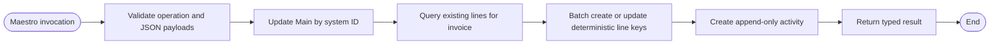

# Solution Design Document — InvoiceAssurancePersistence

## Document History

| Date | Version | Author | Role | Comments |
|---|---|---|---|---|
| 2026-08-09 | 1.0 | Codex | Generated by AI Agent | Approved Studio Web persistence adapter for folder-level Data Fabric entities |

<!-- DO NOT RENAME: uipath-planner detects SDDs via this exact heading or the marker below. -->
<!-- planner-handoff:v1 -->
## Planner Handoff

| Field | Value |
|---|---|
| **Execution autonomy** | interactive |
| **Delivery model** | cloud |
| **SDD scope** | solution |
| **Project list section** | §11 Project Structure |
| **Tasks file** | `healthcare-invoice-assurance-tasks.md` |
| **Generated by** | uipath-planner |
| **Generation date** | 2026-08-09 |

## Recommended Scope

**Recommendation:** RPA Process (portable XAML) inside the `Healthcare Invoice Assurance` Solution

**Delivery model:** cloud

**Blocked by platform:** direct Maestro and Data Fabric connector access to folder-level entities; resolved by the approved Studio Web native Data Service activity adapter

## Table of Contents

1. Process Overview
2. Process Map
3. Detailed Process Steps
4. Business Rules
5. Data Definitions
6. Value Mappings
7. Exception Handling
8. Error Handling
9. Application Inventory
10. Master Project Architecture
11. Project Structure
12. Queue Architecture
13. Implementation Mode
14. Packages
15. Credentials & Assets
16. Deployment Environment
17. Testing Strategy
18. Next Steps

## 1. Process Overview

| Field | Value |
|---|---|
| **Process name** | InvoiceAssurancePersistence |
| **Objective** | Perform the exact folder-scoped Data Fabric writes prepared by `InvoiceAssuranceFlow` |
| **Department / Function** | Finance — Invoice assurance |
| **Schedule** | Synchronous invocation from Maestro |
| **Volume** | Demo-grade; one call per state-changing Flow stage |
| **Avg. handling time (automated target)** | Under 10 seconds per invocation |
| **Exception rate** | Fail closed on any invalid payload or unresolved folder resource |

### In Scope

- Validate the operation and record payloads supplied by Maestro.
- Update an existing `HLS_InvoiceAssurance_Main` record by its system ID.
- Upsert the current `HLS_InvoiceAssurance_LineItems` view deterministically.
- Append one `HLS_InvoiceAssurance_Activity` event.
- Return a typed persistence result to Maestro.

### Out of Scope

- Business decisions, financial calculations, or evidence interpretation.
- Creating the initial Main record; the Main App owns that step.
- Data Fabric Integration Service connector activities.
- Tenant-scoped or cross-folder entity substitutions.
- Queues, UI automation, retries that can duplicate successful writes, and ERP posting.

## 2. Process Map



| Step | Description | Application |
|---|---|---|
| 1 | Validate input contract and size limits | Workflow runtime |
| 2 | Update the supplied Main fields by `invoiceRecordId` | Data Fabric |
| 3 | Resolve and upsert supplied line rows | Data Fabric |
| 4 | Append the supplied activity row | Data Fabric |
| 5 | Return exact counts and record identifiers | Workflow runtime |

## 3. Detailed Process Steps

### Step Summary

| # | Action | Application | Input | Output | Rules | Errors |
|---|---|---|---|---|---|---|
| 1 | Validate invocation | Runtime | operation and JSON arguments | parsed payload | BR-01, BR-02, BR-06 | B1, B2 |
| 2 | Update Main | Data Fabric | system ID and selected fields | updated Main ID | BR-03, BR-07 | E1, E2 |
| 3 | Query and upsert lines | Data Fabric | line rows | created/updated counts | BR-04, BR-07 | B3, E2, E3 |
| 4 | Append activity | Data Fabric | activity row | activity ID | BR-05, BR-07 | E2 |
| 5 | Return result | Runtime | write results | typed output | BR-08 | E4 |

### Step Details

#### Step 1 — Validate invocation

Deserialize only the three documented JSON arguments. Reject unknown operations, malformed JSON, missing required fields, non-GUID `invoiceRecordId`, and strings that exceed the approved entity limits before starting any Data Fabric activity.

#### Step 3 — Deterministic line-item upsert

Query rows by `InvoiceRecordId`. Match each supplied row on `(InvoiceRecordId, ExternalRecordId)`. The Flow guarantees a non-empty `ExternalRecordId`, falling back to the canonical `chargeId`. Create missing rows and update matching rows in batches. Duplicate keys in one request are a business exception.

## 4. Business Rules

| ID | Rule Name | Description | Trigger Condition | Validation | Affected Steps |
|---|---|---|---|---|---|
| BR-01 | Supported operation | Only documented persistence stages are accepted | Every call | `{MarkProcessing, PersistInitial, PersistReviewer, PersistReevaluation, Finalize}` | 1 |
| BR-02 | Main system identifier | The Main record ID must be a GUID string | Every call | 36-character GUID | 1, 2 |
| BR-03 | Partial Main update | Update only fields present in `mainRecordJson`; never overwrite omitted fields | Every call | At least one approved Main field | 2 |
| BR-04 | Stable line key | One line per `(InvoiceRecordId, ExternalRecordId)` in the current view | Calls containing lines | Both values non-empty; no duplicate request keys | 3 |
| BR-05 | Append-only activity | Each successful state-changing call creates exactly one new Activity record | Every call | All seven required Activity fields present | 4 |
| BR-06 | Approved field limits | JSON-backed entity fields must fit their approved `MULTILINE_TEXT` limits | Before writes | `FindingsJson`, `DocumentReferencesJson`, `PayloadJson`, `SourceCoordinatesJson` ≤ 10,000 characters | 1 |
| BR-07 | Folder scope | All entity activities resolve the Solution folder resources | Every Data Fabric activity | Scope `Folder`; HLS solution resource keys only | 2–4 |
| BR-08 | Exact result | The helper reports only confirmed writes | After activities complete | `success=true` only after every requested write succeeds | 5 |

## 5. Data Definitions

### Transaction Data (Dictionary)

| Key | Type | Source | Description |
|---|---|---|---|
| `operation` | String | Maestro | Supported persistence stage |
| `invoiceRecordId` | String | Maestro | Main system GUID |
| `correlationId` | String | Maestro | Cross-component correlation ID |
| `mainRecordJson` | String | Maestro | Approved partial Main record fields |
| `lineRecordsJson` | String | Maestro | Array of approved LineItems rows; `[]` when none |
| `activityRecordJson` | String | Maestro | One approved Activity row |

### Output Data (Dictionary)

| Key | Type | Description |
|---|---|---|
| `success` | Boolean | True only when all requested writes completed |
| `operation` | String | Echoed operation |
| `invoiceRecordId` | String | Updated Main ID |
| `activityRecordId` | String | Created Activity system ID |
| `lineItemsCreated` | Int32 | Confirmed created row count |
| `lineItemsUpdated` | Int32 | Confirmed updated row count |
| `errorCode` | String | Empty on success; typed code on failure |
| `errorMessage` | String | Empty on success; safe diagnostic on failure |

### Status/Category Values

| Variable | Allowed Values |
|---|---|
| `operation` | `MarkProcessing`, `PersistInitial`, `PersistReviewer`, `PersistReevaluation`, `Finalize` |
| `errorCode` | `ValidationError`, `MainNotFound`, `DuplicateLineKey`, `DataFabricWriteFailed`, `UnexpectedError`, empty |

## 6. Value Mappings

### Operation to Data Fabric actions

| Source Value | Target Value |
|---|---|
| `MarkProcessing` | Partial Main update + Activity create |
| `PersistInitial` | Partial Main update + LineItems upsert + Activity create |
| `PersistReviewer` | Partial Main update + optional LineItems upsert + Activity create |
| `PersistReevaluation` | Partial Main update + affected LineItems upsert + Activity create |
| `Finalize` | Partial Main update + Activity create |

## 7. Exception Handling

| ID | Exception Name | Trigger Step | Trigger Condition | Action |
|---|---|---|---|---|
| B1 | Invalid payload | 1 | Missing/invalid required value, malformed JSON, or oversized text | Return `ValidationError`; perform no writes |
| B2 | Unsupported operation | 1 | `operation` outside BR-01 | Return `ValidationError`; perform no writes |
| B3 | Duplicate line key | 3 | Duplicate `(InvoiceRecordId, ExternalRecordId)` in one request | Return `DuplicateLineKey`; do not start the line batch |

**Default handler:** fail closed and return a typed, non-sensitive error to Maestro.

## 8. Error Handling

| ID | Error Name | Trigger Step | Trigger Condition | Retry Policy | Action |
|---|---|---|---|---|---|
| E1 | Main record absent | 2 | Native Get/Update cannot resolve `invoiceRecordId` | No automatic retry | Return `MainNotFound` |
| E2 | Data Fabric activity failure | 2–4 | Native create/query/update reports failure | No helper-level retry after a possible write | Return `DataFabricWriteFailed` with confirmed counts |
| E3 | Batch partial failure | 3 | One or more line records fail | No implicit replay | Return failure and per-batch confirmed counts |
| E4 | Unexpected runtime error | Any | Unhandled exception | No automatic retry | Return `UnexpectedError`; log correlation ID |

**Default handler:** never report success or replay a write whose completion is uncertain.

## 9. Application Inventory

| # | Application | Interface | Access Method | Role | Interaction Pattern | Session Management |
|---|---|---|---|---|---|---|
| 1 | UiPath Data Fabric | API | Native `UiPath.DataService.Activities` in Studio Web Solution context | Target | Read-write | Per run |
| 2 | UiPath Maestro | Process invocation | Synchronous Orchestrator process call | Source | Transient | Per run |

No interactive authentication or UI automation is used.

## 10. Master Project Architecture

Single atomic RPA Process. No queue or independent transactions justify a Master Project or REFramework.

## 11. Project Structure

### Project Type

| # | Project Name | Sub-type |
|---|---|---|
| 1 | `InvoiceAssurancePersistence` | Process |

### Recommended Structure

```text
InvoiceAssurancePersistence/
├── project.json
├── Main.xaml
└── .entities/
    └── EntitiesStore.json
```

### Workflow Inventory

| # | Workflow File | Responsibility | Inputs | Outputs |
|---|---|---|---|---|
| 1 | `Main.xaml` | Validate, update Main, upsert lines, append Activity, and return exact result | §5 transaction fields | §5 output fields |

### Workflow Dependencies

```text
Main.xaml
├── native Main Get/Update activities
├── native LineItems Query/CreateMultiple/UpdateMultiple activities
└── native Activity Create activity
```

## 12. Queue Architecture

Not applicable. The helper is an atomic synchronous invocation and must not introduce a queue.

## 13. Implementation Mode

**Recommendation:** portable XAML with Visual Basic expressions.

The process is a short activity-oriented sequence whose defining requirement is Studio Web native Data Service support. XAML provides the folder-entity resource bindings and batch activity cards directly; no UI automation, custom DTO library, or REFramework is warranted.

## 14. Packages

| Package | Version | Purpose |
|---|---|---|
| `UiPath.System.Activities` | Latest compatible | Core control flow, logging, and JSON-safe workflow primitives |
| `UiPath.DataService.Activities` | Latest compatible | Native folder-scoped entity query/create/update and batch activities |
| `UiPath.WebAPI.Activities` | Latest compatible | JSON deserialization for the three documented payload arguments |

No Integration Service package or Data Fabric connector is allowed.

## 15. Credentials & Assets

No credential or configuration asset is required. Runtime authorization derives from the deployed Solution/process identity and folder bindings.

## 16. Deployment Environment

### Robot & Runtime

| Field | Value |
|---|---|
| **Robot type** | Unattended serverless/cross-platform runtime |
| **Trigger** | Synchronous process invocation from Maestro |
| **Orchestrator tenant / folder** | `Playground` / `AMER Presales/HLS` |
| **UiPath Studio version** | Studio Web current cloud release |
| **UiPath Robot version** | Automation Cloud managed runtime |
| **Orchestrator** | Automation Cloud |
| **Cross-platform / Windows-only** | Cross-platform / Portable |
| **Source repository** | Current Healthcare Invoice Assurance workspace |
| **Shared libraries referenced** | None |

### Development & Production Hosts

| Environment | Machine Name(s) / VM Pool | Notes |
|---|---|---|
| Development | Studio Web serverless debug | Folder entity override bound to HLS |
| Demo | Automation Cloud managed runtime | Deployed with the Solution to HLS |

### Runtime Prerequisites

- The three approved folder-level entities exist in `AMER Presales/HLS`.
- The project is registered in the `Healthcare Invoice Assurance` Solution.
- All native Data Service activities resolve their folder-scoped Solution resources.

### Scalability & Concurrency

| Field | Value |
|---|---|
| **Scalable (multi-robot)?** | Yes for separate invoice records |
| **Concurrent job limit** | Demo default |
| **Peak window** | On demand |

## 17. Testing Strategy

### Canonical Test Case

| Field | Value |
|---|---|
| `invoiceRecordId` | A fresh HLS Main system GUID created by the Main App or test setup |
| `operation` | `PersistInitial` |
| `lineRecordsJson` | Two distinct rows with stable `ExternalRecordId` values |
| `activityRecordJson` | One valid analysis event |

### Happy Path Assertions

1. Main contains only the requested updated fields.
2. Two line rows are created on first invocation.
3. Repeating the invocation updates the same two lines rather than creating duplicates.
4. Each successful invocation appends exactly one Activity row.
5. All records exist only in the HLS folder-level entities.

### Exception Test Cases

| Exception ID | Test Setup | Trigger | Expected Outcome |
|---|---|---|---|
| B1 | Oversized `PayloadJson` | Invoke helper | `ValidationError`; no writes |
| B2 | Unknown operation | Invoke helper | `ValidationError`; no writes |
| B3 | Duplicate line keys | Invoke helper | `DuplicateLineKey`; no line batch |

### System Error Scenarios

| Error ID | Testable in Dev? | How to Simulate | Expected Outcome |
|---|---|---|---|
| E1 | Yes | Use a nonexistent Main GUID | `MainNotFound` |
| E2 | Yes | Remove/override an entity binding in debug | `DataFabricWriteFailed` |
| E3 | Yes | Supply one invalid line row | Failure with confirmed counts; no implicit replay |

## 18. Next Steps

Implement through `uipath-rpa`, validate and build after every XAML change, add the project through `uipath-solution`, then bind the published process synchronously in `InvoiceAssuranceFlow`. The terminal deliverable remains the packed, published, deployed, and activated `Healthcare Invoice Assurance` Solution.
