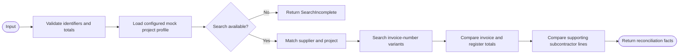

# Solution Design Document — ProjectCostLookupApi

## Document History

| Date | Version | Author | Role | Comments |
|---|---|---|---|---|
| 2026-08-07 | 1.0 | Codex | Generated by AI Agent | Initial interactive SDD |

<!-- DO NOT RENAME: uipath-planner detects SDDs via this exact heading or the marker below. -->
<!-- planner-handoff:v1 -->
## Planner Handoff

| Field | Value |
|---|---|
| **Execution autonomy** | interactive |
| **Delivery model** | cloud |
| **SDD scope** | solution |
| **Project list section** | §10 Project Structure + §5 Connectors & External Calls |
| **Tasks file** | `project-cost-lookup-api-tasks.md` |
| **Generated by** | uipath-planner |
| **Generation date** | 2026-08-07 |

## Recommended Scope

**Recommendation:** API Workflow as a deterministic mock adapter within the solution

**Delivery model:** cloud

**Blocked by platform:** none

## Table of Contents

1. API Workflow Overview
2. Input Schema
3. Output Schema
4. Execution Flow
5. Connectors & External Calls
6. Error Handling
7. Performance & Scaling
8. Security & Authentication
9. Consumers
10. Project Structure
11. Testing Strategy
12. Next Steps

## 1. API Workflow Overview

| Field | Value |
|---|---|
| **API Workflow name** | ProjectCostLookupApi |
| **Objective** | Simulate a project-cost lookup and return structured reconciliation facts without PO matching |
| **Primary use case** | Data retrieval and reconciliation adapter |
| **Invocation pattern** | Synchronous request-response |
| **Expected latency** | Under 2 seconds for demo-size input |
| **Expected throughput** | Demo-grade; reusable for modest parallel test runs |

### In Scope

- Validate account/project selection.
- Match supplier identity against configured project suppliers.
- Search optional mock invoice records by normalized invoice-number variants.
- Compare invoice total with uploaded cost-register total.
- Compare register subcontractor lines with their supplied supporting invoices.
- Return `Found`, `NotFound`, or `SearchIncomplete` distinctly.
- Return reconciliation facts without deciding contract allowability.

### Out of Scope

- PO matching.
- Contract interpretation.
- Financial deductions.
- Live ERP, project-cost, or supplier-system calls.
- Hard-coded expected adjustments/findings.

## 2. Input Schema

| Field | Type | Required | Description | Example |
|---|---|---|---|---|
| `correlationId` | string | Yes | Trace identifier | `corr-...` |
| `contractProfileId` | string | Yes | Selected profile | `profile-fictional-project` |
| `accountId` | string | Yes | Selected account/client identifier | `acct-demo` |
| `projectId` | string | Yes | Selected project identifier | `project-demo` |
| `supplier` | object | Yes | Supplier name and normalized identifiers | `{...}` |
| `invoice` | object | Yes | Invoice number, date, total, currency | `{...}` |
| `register` | object/null | No | Uploaded register total and lines | `{...}` |
| `supportingInvoices` | array | No | Extracted supporting subcontractor invoices | `[]` |

### Sample Input

```json
{
  "correlationId": "corr-example",
  "contractProfileId": "profile-example",
  "accountId": "account-example",
  "projectId": "project-example",
  "supplier": { "name": "Fictional Supplier" },
  "invoice": { "number": "INV-EXAMPLE", "total": 1000.00, "currency": "USD" },
  "register": { "total": 1000.00, "lines": [] },
  "supportingInvoices": []
}
```

Sample values demonstrate shape only and are not runtime fixtures.

## 3. Output Schema

| Field | Type | Always Present | Description | Example |
|---|---|---|---|---|
| `searchStatus` | enum | Yes | `Found`, `NotFound`, or `SearchIncomplete` | `Found` |
| `supplierMatch` | object | Yes | Match state, matched ID, and normalized comparison | `{...}` |
| `projectMatch` | object | Yes | Project eligibility/search result | `{...}` |
| `invoiceRecord` | object/null | Yes | Optional mock cost-system invoice record | `{...}` |
| `invoiceRegisterComparison` | object | Yes | Totals, variance, and comparison status | `{...}` |
| `supportingDocumentComparisons` | array | Yes | Per-register-line supporting invoice comparison | `[]` |
| `searchesAttempted` | array | Yes | Configured search methods in order | `[]` |
| `warnings` | array | Yes | Non-fatal data-quality notes | `[]` |
| `errorType` | string | Yes | Empty on successful completed search | `` |
| `errorMessage` | string | Yes | Safe technical detail | `` |

### Sample Output

```json
{
  "searchStatus": "Found",
  "supplierMatch": { "matched": true },
  "projectMatch": { "matched": true },
  "invoiceRecord": null,
  "invoiceRegisterComparison": { "status": "Tied", "variance": 0.00 },
  "supportingDocumentComparisons": [],
  "searchesAttempted": ["project-profile", "normalized-invoice-number"],
  "warnings": [],
  "errorType": "",
  "errorMessage": ""
}
```

## 4. Execution Flow



### Step Details

| # | Step | Activity Type | Input | Output | Notes |
|---|---|---|---|---|---|
| 1 | Validate input | Logic/script | Request | Valid request/errors | Decimal and identifier validation |
| 2 | Load mock profile | Data lookup | Profile/account/project IDs | Project configuration | Deterministic seeded configuration |
| 3 | Determine search availability | If | Profile state | Available/incomplete | Simulates a system outage explicitly |
| 4 | Match supplier/project | Transform | Supplier and profile | Match objects | Normalized comparison |
| 5 | Search invoice variants | Loop/transform | Invoice number variants | Optional record | Search order comes from profile |
| 6 | Compare register | Transform | Invoice/register totals | Variance/status | Variance is reconciliation fact, not deduction |
| 7 | Compare supporting invoices | Loop/transform | Register lines/support docs | Line comparisons | Each subcontract line maps to its own document |
| 8 | Return result | Response | All facts | Typed response | Always distinguish incomplete from not found |

## 5. Connectors & External Calls

### Integration Service Connectors

None. The primary design is an intentionally local deterministic mock.

### Direct HTTP Calls

None. A later real-system adapter may replace this project behind the same input/output contract.

### Mock data source

The adapter uses a small configuration dataset for fictional accounts, projects, suppliers, system availability, and optional invoice records. It does not contain expected contract findings or financial adjustments. New invoices may legitimately return no mock invoice record while contract analysis continues with a reconciliation finding.

## 6. Error Handling

### Known Error Scenarios

| Error Type | Source | Logical status | Response behavior |
|---|---|---|---|
| `ValidationError` | Invalid request | Invalid | Return field errors; no search attempted |
| `ProfileNotFound` | Unknown account/project/profile | `NotFound` | Return completed search with no project match |
| `SearchUnavailable` | Simulated system outage | `SearchIncomplete` | Return attempted searches and retryable warning |
| `InvoiceNotFound` | Completed search has no invoice record | `NotFound` | Return supplier/project and register facts that are available |
| `UnexpectedFailure` | Workflow defect | Technical error | Return safe typed error for Flow handling |

`NotFound` is a business search result. `SearchIncomplete` is a technical/incomplete result. They must never be collapsed.

### Retry Policy

| Operation | Retry Count | Backoff | Timeout |
|---|---|---|---|
| Load mock configuration | 1 | Constant | 2 seconds |
| Search/transform logic | 0 | — | 2 seconds total target |

## 7. Performance & Scaling

| Metric | Target |
|---|---|
| p50 latency | Under 500 ms |
| p99 latency | Under 2 seconds |
| Max request package | Metadata only; no document binaries |
| Determinism | Identical configuration and inputs produce identical results |

The adapter is demo-grade. Its contract permits replacement by a live Integration Service or HTTP-backed adapter later.

## 8. Security & Authentication

### Authentication to the API Workflow

- Invoked from the authenticated Maestro Flow within the Automation Cloud solution.

### Authentication to External Systems

No external-system credentials are required for the mock adapter.

### Rate Limits

No vendor limit applies. Flow-level concurrency controls protect the demo environment.

## 9. Consumers

| Consumer Type | Consumer Name | Usage Pattern |
|---|---|---|
| Flow | `InvoiceAssuranceFlow.lookupProjectCost` | Once per initial analysis; may be re-run only if reconciliation inputs change |

The Agent receives the resulting facts but does not call the adapter itself.

## 10. Project Structure

```text
HealthcareInvoiceAssurance/
└── ProjectCostLookupApi/
    ├── project.uiproj
    ├── Workflow.json
    ├── entry-points.json
    └── bindings_v2.json
```

### Deployment Target

- Authored in Studio Web as an API Workflow.
- Registered in the `.uipx` by the API Workflow project scaffold.
- Packaged and published through the solution lifecycle.

## 11. Testing Strategy

### Canonical Test Cases

| Test ID | Input | Expected Output | Expected Latency |
|---|---|---|---|
| API-01 | Known fictional project and supplier with tying register | `Found`; tied comparison | Under 2 seconds |
| API-02 | Known project with register variance | `Found`; exact input-derived variance | Under 2 seconds |
| API-03 | Unknown invoice record | `NotFound`; completed search facts retained | Under 2 seconds |
| API-04 | Simulated unavailable search | `SearchIncomplete`; retryable warning | Under 2 seconds |
| API-05 | Different supported invoice under known project | Result reflects its own totals and register | Under 2 seconds |

### Error Path Tests

| Test ID | Input | Expected logical status | Expected behavior |
|---|---|---|---|
| API-E1 | Missing project ID | Invalid | Field validation error |
| API-E2 | Malformed decimal | Invalid | No comparison attempted |
| API-E3 | Duplicate register line IDs | Invalid | Typed data-quality error |
| API-E4 | Supporting invoice missing | Completed | Line comparison records missing support; no technical failure |

### Load Tests

Run modest parallel calls to verify deterministic output and no shared mutable state. Large-scale load testing is deferred until a real external-system adapter exists.

## 12. Next Steps

This SDD captures architecture only. If implementation is authorized later, load `uipath-planner` with this file or the solution overview to derive a separate task list. No API Workflow asset is created by this document.
